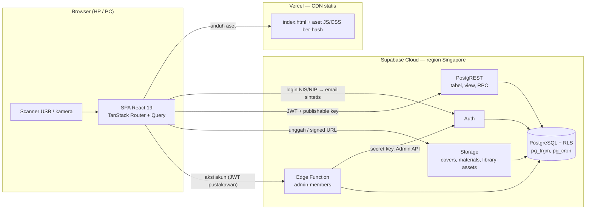
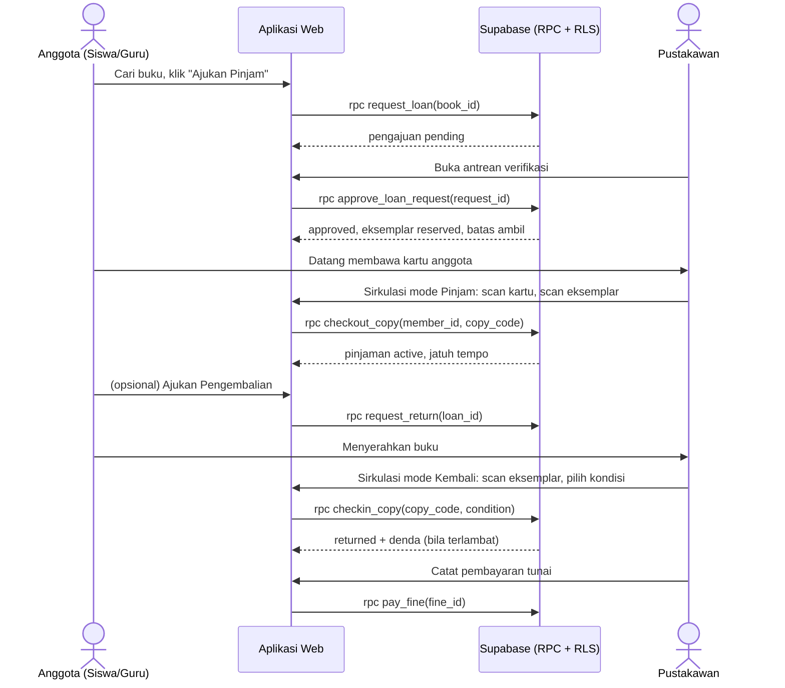
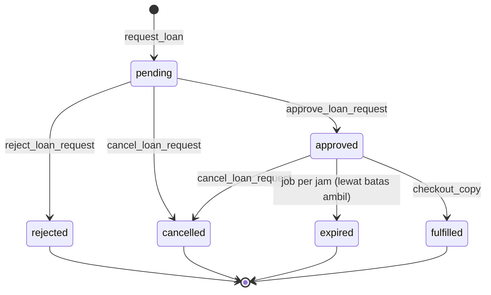
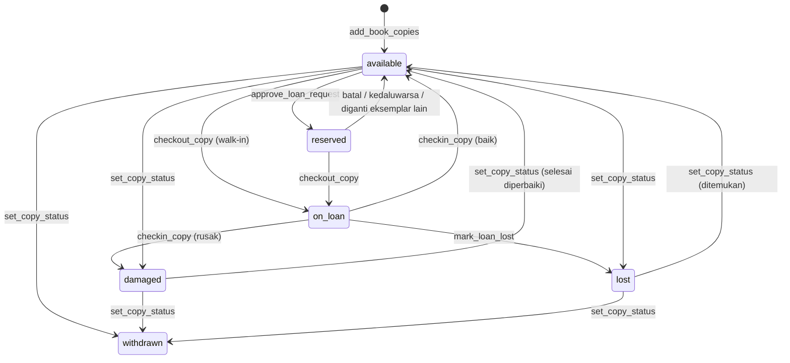
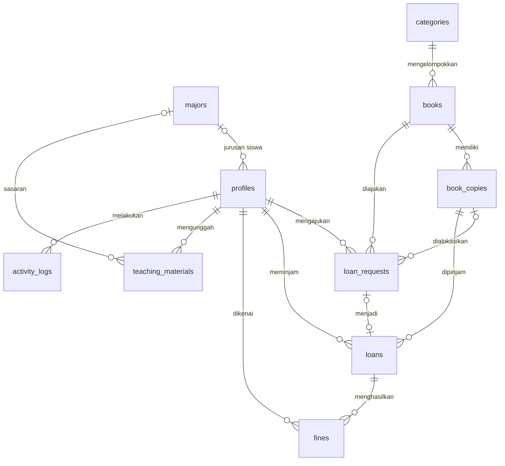

# PRD — Sistem Informasi Perpustakaan Berbasis Web SMKN 1 Selayar

> *Product Requirements Document* teknis. Diturunkan dari proposal skripsi **"Rancang Bangun Sistem Informasi Perpustakaan Berbasis Web pada SMKN 1 Selayar"** dan keputusan konfirmasi tanggal 22 Oktober 2026.

| Atribut | Nilai |
|---|---|
| Versi | 1.0 — *baseline requirement* (keluaran tahap Analisis Kebutuhan, model Waterfall) |
| Tanggal | 22 Oktober 2026 |
| Peneliti / pemilik produk | Muh. Nur Wahyu Ihsan (210210502055) — Prodi Teknik Komputer, JTIK, FT Universitas Negeri Makassar |
| Lokasi implementasi | Perpustakaan SMKN 1 Selayar, Kab. Kepulauan Selayar, Sulawesi Selatan |
| Nama kerja sistem | SIP SMKN 1 Selayar (repositori: `sip-smkn1-selayar`) |
| Dokumen terkait | `CLAUDE.md` (aturan pengembangan), `docs/testing/black-box.md` (katalog uji) |

## Daftar isi

1. [Konvensi dokumen](#1-konvensi-dokumen)
2. [Ringkasan](#2-ringkasan)
3. [Latar belakang & pernyataan masalah](#3-latar-belakang--pernyataan-masalah)
4. [Tujuan & indikator keberhasilan](#4-tujuan--indikator-keberhasilan)
5. [Ruang lingkup](#5-ruang-lingkup)
6. [Pengguna & hak akses](#6-pengguna--hak-akses)
7. [Arsitektur & teknologi](#7-arsitektur--teknologi)
8. [Kebutuhan fungsional](#8-kebutuhan-fungsional)
9. [Aturan bisnis](#9-aturan-bisnis)
10. [Alur proses & status](#10-alur-proses--status)
11. [Model data](#11-model-data)
12. [Antarmuka backend (API)](#12-antarmuka-backend-api)
13. [Keamanan & privasi](#13-keamanan--privasi)
14. [Kebutuhan non-fungsional (ISO/IEC 25010)](#14-kebutuhan-non-fungsional-isoiec-25010)
15. [Antarmuka pengguna](#15-antarmuka-pengguna)
16. [Strategi pengujian](#16-strategi-pengujian)
17. [Deployment & operasional](#17-deployment--operasional)
18. [Rencana rilis (Waterfall)](#18-rencana-rilis-waterfall)
19. [Risiko & mitigasi](#19-risiko--mitigasi)
20. [Pertanyaan terbuka](#20-pertanyaan-terbuka)
- [Lampiran A — Glosarium](#lampiran-a--glosarium-istilah-ui--nama-teknis)
- [Lampiran B — Pemetaan use case & mockup ke FR](#lampiran-b--pemetaan-use-case--mockup-proposal-ke-fr)
- [Lampiran C — Dampak terhadap dokumen skripsi](#lampiran-c--dampak-terhadap-dokumen-skripsi)
- [Lampiran D — Changelog](#lampiran-d--changelog)

---

## 1. Konvensi dokumen

- **HARUS** = wajib (MoSCoW *Must*, kode **M**); **SEBAIKNYA** = *Should* (**S**); **BOLEH** = *Could* (**C**); *Won't (v1)* = di luar cakupan rilis ini.
- Format ID:
  - `P-NN` masalah, `G-N` tujuan produk, `ADR-NN` keputusan arsitektur
  - `FR-<MODUL>-NN` kebutuhan fungsional, `BR-NN` aturan bisnis, `NFR-<KAR>-NN` kebutuhan non-fungsional
  - `TC-<MODUL>-NN` kasus uji
- Kode modul: **AUTH** (autentikasi), **MBR** (anggota), **CARD** (kartu anggota), **CAT** (katalog), **COL** (koleksi), **CIR** (sirkulasi), **FIN** (denda), **MAT** (bahan ajar), **DSH** (beranda), **RPT** (laporan), **SET** (pengaturan), **LOG** (log aktivitas).
- Istilah antarmuka memakai Bahasa Indonesia. Nama teknis (tabel, kolom, fungsi, enum) memakai bahasa Inggris; padanannya ada di Lampiran A.
- Rujukan gambar mengikuti *caption* di badan proposal: Gambar 3.2 *use case* Siswa, 3.3 *use case* Pustakawan, 3.4 *use case* Guru, 3.5 *activity* Pustakawan, 3.6 *activity* Siswa, 3.7 *activity* Guru, 3.8 ERD, 3.9 mockup Login, 3.10 mockup Dashboard.

---

## 2. Ringkasan

SIP SMKN 1 Selayar adalah aplikasi web berbentuk *Single Page Application* yang menggantikan pencatatan perpustakaan berbasis buku besar dengan basis data terpusat. Sistem melayani tiga aktor (Siswa, Guru, Pustakawan) dengan fitur berikut:

- katalog daring dengan ketersediaan eksemplar *real-time*;
- pengajuan pinjam online yang diverifikasi pustakawan;
- sirkulasi di meja layanan berbasis pemindaian barcode/QR;
- denda keterlambatan otomatis;
- unggah dan unduh bahan ajar;
- kartu anggota ber-QR;
- laporan otomatis yang dapat diekspor ke PDF dan Excel.

**Keputusan kunci (dikonfirmasi 22 Oktober 2026)**

| Aspek | Keputusan |
|---|---|
| Frontend | React 19 + TypeScript, Vite (SPA), TanStack Router, TanStack Query |
| Backend | Supabase: PostgreSQL + Row Level Security, Auth, Storage, fungsi RPC (PL/pgSQL), Edge Functions |
| Hosting | Vercel (frontend statis) + Supabase Cloud |
| Alur sirkulasi | Anggota mengajukan pinjam online, lalu pustakawan memverifikasi, lalu buku diserahkan di meja layanan. Pustakawan juga dapat mencatat pinjam langsung (*walk-in*). Pengembalian sah setelah pustakawan mengonfirmasi buku diterima. |
| Akun & login | Akun dibuat pustakawan (manual atau impor Excel). Login memakai NIS/NIP + password, dan password wajib diganti saat login pertama. |
| Denda | Denda uang per hari keterlambatan, dicatat dan ditagih, **tidak** memblokir peminjaman. |
| Fitur tambahan | Barcode per eksemplar; cetak kartu anggota ber-QR |
| Peran | Tiga peran sesuai diagram proposal; pustakawan merangkap admin |

---

## 3. Latar belakang & pernyataan masalah

Kondisi awal (observasi di Perpustakaan SMKN 1 Selayar; BAB I dan Gambar 2.1 proposal):

- pendaftaran anggota, peminjaman, dan pengembalian masih dicatat manual di buku besar;
- belum ada katalog daring;
- jumlah pustakawan terbatas;
- laporan disusun manual.

| ID | Masalah | Dampak | Sumber di proposal | Jawaban sistem |
|---|---|---|---|---|
| P-01 | Pencatatan anggota, peminjaman, dan pengembalian di buku besar | Rawan salah catat; pencarian data lama | Latar belakang (observasi); Kerangka Pikir | Basis data terpusat + validasi otomatis (MBR, CIR) |
| P-02 | Tidak ada katalog daring | Pengguna harus datang untuk mengecek ketersediaan | Latar belakang (observasi) | Katalog daring dengan ketersediaan per eksemplar (CAT) |
| P-03 | Pencarian koleksi tidak efektif dan efisien | Layanan lambat | Kerangka Pikir | Pencarian judul/penulis/ISBN + filter (CAT) |
| P-04 | Tenaga pustakawan terbatas, antre di jam sibuk | Layanan kurang optimal | Latar belakang (observasi) | Pengajuan online + verifikasi; sirkulasi berbasis scan (CIR) |
| P-05 | Penyusunan laporan bulanan lama | Keputusan tidak berbasis data | Kerangka Pikir; Teknik Pengumpulan Data | Laporan otomatis + ekspor PDF/Excel (RPT) |
| P-06 | Akses internet dan SDM TI terbatas di wilayah kepulauan | Sistem harus tetap layak pakai di jaringan terbatas | Latar belakang | Aplikasi ringan, cache klien, UI sederhana (NFR-PE, NFR-US) |
| P-07 | Belum ada sarana berbagi bahan ajar digital | Modul sulit diakses siswa | Latar belakang (guru mengunggah, siswa mengunduh) | Modul bahan ajar (MAT) |
| P-08 | Keterlambatan dan denda tidak tercatat sistematis | Penagihan tidak konsisten | Kajian Penelitian Relevan (fitur denda) | Denda otomatis (FIN) |

---

## 4. Tujuan & indikator keberhasilan

### 4.1 Tujuan penelitian → tujuan produk

| Tujuan penelitian (proposal) | Tujuan produk | Bukti |
|---|---|---|
| **T1** — Menghasilkan sistem informasi layanan perpustakaan berbasis web pada SMKN 1 Selayar | **G-1** Seluruh FR prioritas **M** terimplementasi dan berjalan di produksi | Aplikasi terdeploy; hasil black-box |
| | **G-2** Proses inti (anggota, koleksi, sirkulasi, denda, laporan) tidak lagi bergantung pada buku besar | UAT pustakawan |
| **T2** — Mengetahui hasil pengujian sistem dengan ISO 25010 | **G-3** Sistem terukur pada 4 karakteristik terpilih (Functional Suitability, Usability, Performance Efficiency, Portability) dengan instrumen yang jelas | §14, §16 |
| | **G-4** Hasil minimal "Valid" (functional suitability) dan "Layak" (usability) | Instrumen Tabel 3.1–3.6 proposal |

### 4.2 Indikator keberhasilan

| Indikator | Target | Cara ukur |
|---|---|---|
| Kelengkapan FR prioritas M | 100% | Daftar periksa §8 + black-box |
| Kelulusan black-box (TC untuk FR prioritas M) | 100% lulus sebelum validasi ahli | `docs/testing/black-box.md` |
| Validasi ahli Functional Suitability (Guttman) | Setiap indikator ≥ 50% "Valid" (ambang proposal); target internal 100% | Instrumen Tabel 3.1 |
| Usability (kuesioner USE, Likert 5) | ≥ 61% "Layak"; target ≥ 81% "Sangat Layak" | Instrumen Tabel 3.2, konversi Tabel 3.6 |
| Performance Efficiency | Skor Lighthouse mobile ≥ 80, LCP ≤ 2,5 s pada halaman utama | §16.3 |
| Portability | 100% skenario lulus di matriks browser/perangkat | Playwright + uji manual |
| Waktu satu transaksi di meja layanan | ≤ 30 detik dengan scanner | Observasi saat UAT (bandingkan dengan proses manual) |
| Waktu menyusun laporan bulanan | ≤ 1 menit (pilih periode + ekspor) | Observasi saat UAT |

---

## 5. Ruang lingkup

### 5.1 Dalam cakupan v1

1. Autentikasi NIS/NIP, ganti password, dan pembatasan akses per peran.
2. Manajemen anggota oleh pustakawan: tambah, ubah, nonaktifkan, reset password, impor Excel; termasuk akun pustakawan.
3. Kartu anggota PDF dengan QR (individu dan massal).
4. Katalog daring (wajib login) dengan ketersediaan *real-time*.
5. Manajemen koleksi: kategori, buku (judul), eksemplar ber-barcode, cetak label barcode.
6. Sirkulasi:
   - pengajuan online, verifikasi, dan kedaluwarsa otomatis;
   - penyerahan dan pengembalian buku di meja dengan scan;
   - pinjam langsung (*walk-in*);
   - pengajuan pengembalian oleh anggota;
   - tandai hilang.
7. Denda: keterlambatan otomatis, kerusakan/kehilangan, pembayaran tunai, pembebasan.
8. Bahan ajar: unggah oleh guru, unduh oleh semua pengguna, moderasi oleh pustakawan.
9. Beranda per peran (diadaptasi dari mockup Gambar 3.10).
10. Laporan dan ekspor PDF/Excel.
11. Pengaturan: kebijakan pinjam per peran, profil perpustakaan, jurusan.
12. Log aktivitas.

### 5.2 Di luar cakupan v1 (*Won't*)

| Item | Alasan / catatan |
|---|---|
| Berita perpustakaan dan widget buku populer di beranda (ada di mockup) | Tidak dipilih saat konfirmasi. "Buku paling sering dipinjam" tetap tersedia sebagai laporan (FR-RPT-07). |
| Notifikasi/pengingat jatuh tempo (in-app, email, WhatsApp) | Tidak dipilih saat konfirmasi; status terlambat tetap tampil di beranda. |
| Daftar tunggu otomatis saat stok habis | Tidak dipilih; pengajuan ditolak bila stok 0 (BR-04). |
| Perpanjangan (*renewal*) pinjaman | Tidak disebut di proposal. |
| Katalog publik tanpa login | Diagram aktivitas mensyaratkan login. |
| Pembayaran denda online | Denda dibayar tunai. |
| Mode offline / PWA | Hosting online dipilih; P-06 ditangani lewat optimasi ringan. |
| Koleksi digital / e-book | Di luar proposal. |
| Peran Kepala Sekolah atau Admin terpisah | Tiga aktor sesuai diagram; pustakawan merangkap admin. |
| Pengecualian hari libur dalam hitungan denda | v1 memakai hari kalender. |
| Integrasi Dapodik, SSO, aplikasi mobile native | Di luar proposal. |

### 5.3 Asumsi

- **A-01** Setiap siswa memiliki NIS unik. Setiap guru memiliki NIP, NUPTK, atau kode guru yang unik.
- **A-02** Siswa dan guru umumnya mengakses dari HP (browser Android/iOS); pustakawan dari PC/laptop di meja layanan.
- **A-03** Denda dibayar tunai di perpustakaan, lunas sekaligus.
- **A-04** Seluruh tanggal bisnis mengacu WITA (Asia/Makassar).
- **A-05** Bahan ajar dapat dilihat semua pengguna yang login, tidak dibatasi per kelas.
- **A-06** Nilai awal kebijakan pinjam (dapat diubah di Pengaturan):

  | Peran | Maks. buku aktif | Lama pinjam | Denda per hari | Batas ambil |
  |---|---|---|---|---|
  | Siswa | 5 (mengikuti mockup "03/05") | 7 hari | Rp500 | 2 hari |
  | Guru | 5 | 14 hari | Rp500 | 2 hari |

  Nilai final dikonfirmasi ke pengelola perpustakaan (§20).

### 5.4 Batasan

- **C-01** Infrastruktur memakai Vercel (statis) + Supabase Cloud paket Free selama pengembangan. Batas paket Free:
  - database 500 MB, Storage 1 GB, egress 5 GB/bulan;
  - maksimal 50 MB per berkas;
  - project dijeda otomatis setelah 1 minggu tanpa aktivitas;
  - tidak ada backup harian otomatis.
- **C-02** Rate limit Auth bawaan adalah 30 *sign-in* per 5 menit **per IP**, padahal siswa satu sekolah berbagi IP NAT yang sama (lihat §17.6).
- **C-03** Tidak ada server aplikasi sendiri. Logika server berada di PostgreSQL (fungsi RPC) dan satu Edge Function.
- **C-04** Waktu penelitian Agustus 2026 – Januari 2027.
- **C-05** Kunci API legacy Supabase (`anon`, `service_role`) dideprekasi akhir 2026, sehingga wajib memakai kunci baru (`sb_publishable_…`, `sb_secret_…`).

---

## 6. Pengguna & hak akses

### 6.1 Aktor

| Aktor | Deskripsi | Perangkat utama | Rujukan proposal |
|---|---|---|---|
| Siswa | Anggota; mencari, mengajukan pinjam, mengembalikan, melihat riwayat, mengunduh bahan ajar | HP | Gambar 3.2, 3.6 |
| Guru | Anggota; seperti siswa, ditambah mengunggah bahan ajar | HP / laptop | Gambar 3.4, 3.7 |
| Pustakawan | Guru pengelola perpustakaan dan petugas perpustakaan; mengelola seluruh data (merangkap admin) | PC/laptop + scanner | Gambar 3.3, 3.5 |

### 6.2 Matriks hak akses

| Kemampuan | Siswa | Guru | Pustakawan |
|---|:-:|:-:|:-:|
| Login, logout, ganti password, lihat profil | ✓ | ✓ | ✓ |
| Katalog dan detail buku | ✓ | ✓ | ✓ |
| Ajukan/batalkan pinjam, ajukan pengembalian | ✓ | ✓ | — |
| Pinjaman saya, riwayat, denda saya | ✓ | ✓ | — |
| Telusuri dan unduh bahan ajar | ✓ | ✓ | ✓ |
| Unggah/ubah/hapus bahan ajar milik sendiri | — | ✓ | — |
| Sembunyikan/tampilkan bahan ajar (moderasi) | — | — | ✓ |
| Verifikasi pengajuan, sirkulasi meja, konfirmasi pengembalian, tandai hilang | — | — | ✓ |
| Kelola denda (bayar, bebaskan) | — | — | ✓ |
| Kelola kategori, buku, eksemplar, cetak label | — | — | ✓ |
| Kelola anggota dan pustakawan, impor, reset password, cetak kartu | — | — | ✓ |
| Laporan dan ekspor | — | — | ✓ |
| Pengaturan dan log aktivitas | — | — | ✓ |

Otorisasi ditegakkan di basis data (RLS dan pemeriksaan peran di fungsi). Guard di UI hanya untuk navigasi.

---

## 7. Arsitektur & teknologi

### 7.1 Diagram arsitektur

### 7.2 Tumpukan teknologi

Versi ditulis sebagai versi mayor yang berlaku per Oktober 2026. Versi pasti dikunci di `package.json`.

| Lapisan | Teknologi | Fungsi |
|---|---|---|
| Runtime dev | Node.js 24 LTS (minimal 22.12, syarat Vite 8), npm | Tooling |
| Bahasa | TypeScript ≥ 6 (`strict`) | Keamanan tipe |
| Build | Vite 8 (Rolldown), `@vitejs/plugin-react` | Dev server dan bundling SPA |
| UI | React 19, Tailwind CSS v4 (`@tailwindcss/vite`), shadcn/ui, lucide-react, sonner | Komponen, gaya, ikon, toast |
| Routing | TanStack Router v1 (file-based, `autoCodeSplitting`) | Rute bertipe, guard, search params |
| Data | TanStack Query v5, `@supabase/supabase-js` v2 | Cache server-state, akses API |
| Form & validasi | React Hook Form + Zod v4 | Form dan skema validasi |
| Tabel | TanStack Table v8 | Tabel data pustakawan |
| Tanggal | date-fns + `@date-fns/tz` | Format dan zona WITA |
| Barcode/QR | `bwip-js` (generate Code 128 & QR), `barcode-detector` (polyfill BarcodeDetector berbasis zxing-wasm untuk scan kamera) | Label, kartu, pemindaian |
| PDF | `@react-pdf/renderer` | Kartu anggota, label, laporan |
| Excel | `read-excel-file` (impor), `write-excel-file` (ekspor) | Impor anggota, ekspor laporan |
| Backend | Supabase: PostgreSQL, PostgREST, Auth, Storage, Edge Functions (Deno + `@supabase/server`), pg_cron, pg_trgm | BaaS |
| Pengujian | Vitest 4 + Testing Library, Playwright, pgTAP (`supabase test db`), Lighthouse | Unit, E2E lintas browser, RLS/RPC, performa |
| Hosting | Vercel (statis) + Supabase Cloud (region Southeast Asia/Singapore) | Produksi dan preview |

### 7.3 Lingkungan

| Lingkungan | Frontend | Backend | Kegunaan |
|---|---|---|---|
| Lokal | `npm run dev` | Supabase lokal (`supabase start`, butuh Docker) | Pengembangan, pgTAP |
| Preview | Vercel Preview (per *pull request*) | Project Supabase `sip-dev` | Review; uji kamera di HP (butuh HTTPS) |
| Produksi | Vercel Production (branch `main`) | Project Supabase `sip-prod` | Pemakaian sekolah, UAT |

Jika Docker tidak tersedia, pengembangan memakai project `sip-dev`. Perintah destruktif hanya boleh dijalankan ke `sip-dev`.

### 7.4 Keputusan arsitektur (ADR)

| ID | Keputusan | Alasan | Konsekuensi |
|---|---|---|---|
| ADR-01 | SPA React di Vercel + Supabase sebagai backend, menggantikan Laravel/MySQL pada BAB III | Keputusan pengguna. Tanpa server sendiri, gratis di tahap awal, dan sesuai landasan teori ReactJS di BAB II. | Basis data menjadi PostgreSQL; BAB II/III perlu disesuaikan (Lampiran C) |
| ADR-02 | Transisi status sirkulasi dan denda dijalankan oleh fungsi RPC PL/pgSQL yang atomik | Invariant lintas tabel (stok, batas, denda) tidak cukup dijaga RLS; transaksi DB mencegah *double booking* | Klien tidak pernah menulis langsung ke `loan_requests`, `loans`, `fines` |
| ADR-03 | Login NIS/NIP dipetakan ke email sintetis `<login_id>@<AUTH_EMAIL_DOMAIN>` di Supabase Auth | Supabase Auth berbasis email/telepon; siswa belum tentu punya email | Tidak ada alur email; reset password oleh pustakawan |
| ADR-04 | Operasi akun (buat, impor, reset, nonaktifkan) lewat Edge Function `admin-members` | Membutuhkan secret key (Admin API) yang tidak boleh berada di klien | Satu function dengan aksi bertipe |
| ADR-05 | Tanpa Supabase Realtime; antrean pustakawan memakai *polling* 30 detik + *refetch on focus* | Sederhana, hemat koneksi | Data antrean bisa tertinggal ≤ 30 detik |
| ADR-06 | PDF, Excel, dan barcode dibuat di browser (*lazy-loaded*) | Tidak perlu server tambahan | Bundle pustakawan lebih besar, tetapi tidak membebani rute siswa |
| ADR-07 | Eksemplar (`book_copies`) sebagai unit sirkulasi, bukan angka stok | Akurasi stok, pelacakan per buku fisik, mendukung barcode | Stok = jumlah eksemplar berstatus `available` |
| ADR-08 | Kunci API baru (publishable/secret) sejak awal | Kunci legacy dideprekasi akhir 2026 | Edge Function memakai `@supabase/server` |
| ADR-09 | Kode dan skema berbahasa Inggris, UI berbahasa Indonesia | Konsisten dengan ekosistem library; pluralisasi aman | Glosarium wajib (Lampiran A) |

---

## 8. Kebutuhan fungsional

Kolom **P** berisi prioritas (M/S/C). Kriteria penerimaan rinci diberikan untuk FR berisiko tinggi; FR lain diterima bila perilakunya sesuai deskripsi dan aturan bisnis terkait.

### 8.1 AUTH — Autentikasi & akun

| ID | P | Kebutuhan |
|---|:-:|---|
| FR-AUTH-01 | M | Login dengan **Nomor Induk (NIS/NIP)** + password. Galat login selalu memakai pesan generik "Nomor induk atau password salah". |
| FR-AUTH-02 | M | Logout tersedia dari menu akun di semua halaman; sesi lokal dibersihkan. |
| FR-AUTH-03 | M | Bila `must_change_password = true` (akun baru atau setelah reset), pengguna dialihkan ke halaman ganti password dan tidak dapat membuka rute lain sebelum selesai. |
| FR-AUTH-04 | M | Halaman Profil menampilkan data diri (baca saja) dan form ganti password (minimal 8 karakter + konfirmasi). |
| FR-AUTH-05 | M | Setelah login, semua peran diarahkan ke `/beranda` dengan konten sesuai peran. Rute `/pustakawan/*` hanya untuk pustakawan; peran lain dialihkan ke `/beranda` dengan pesan "Tidak memiliki akses". |
| FR-AUTH-06 | M | Akun nonaktif tidak dapat login; tampil pesan "Akun dinonaktifkan, hubungi pustakawan". |

**Kriteria penerimaan**

- **FR-AUTH-01**
  - **Given** siswa aktif dengan NIS `0071234567`, **when** ia memasukkan `0071234567` dan password yang benar, **then** sesi terbentuk dan beranda siswa tampil.
  - Input dinormalkan sebelum login: spasi dan tanda baca dibuang, huruf dikecilkan. Contoh: `21.10.0456` dan `2110 0456` merujuk akun yang sama.
- **FR-AUTH-03**
  - **Given** akun dengan `must_change_password = true`, **when** pengguna membuka URL apa pun selain `/ganti-password`, **then** ia dialihkan ke `/ganti-password`.
  - Setelah password baru tersimpan, flag menjadi `false` dan pengguna masuk ke beranda.

### 8.2 MBR — Manajemen anggota (pustakawan)

| ID | P | Kebutuhan |
|---|:-:|---|
| FR-MBR-01 | M | Daftar anggota: cari nama/nomor induk; filter peran, kelas, jurusan, dan status aktif; pagination 20 baris. |
| FR-MBR-02 | M | Tambah anggota tunggal dengan field: nomor induk\*, nama\*, peran\* (siswa/guru), kelas\* dan jurusan (siswa), mapel (guru, opsional), telepon (opsional). Sistem membuat **password sementara acak** (10 karakter, tanpa karakter ambigu) yang ditampilkan sekali dan dapat disalin atau dicetak. |
| FR-MBR-03 | M | Ubah data anggota (nama, kelas, jurusan, mapel, telepon). Nomor induk dan peran tidak dapat diubah (BR-15). |
| FR-MBR-04 | M | Nonaktifkan/aktifkan anggota (mis. lulus atau pindah). Riwayat tetap tersimpan. |
| FR-MBR-05 | M | Reset password menghasilkan password sementara baru dan mengeset `must_change_password = true`. |
| FR-MBR-06 | M | Impor anggota dari Excel (`.xlsx`) memakai template yang dapat diunduh. |
| FR-MBR-07 | M | Detail anggota menampilkan profil, pengajuan, pinjaman aktif, riwayat, dan denda; dari sini juga tersedia aksi cetak kartu. |
| FR-MBR-08 | S | Kelola akun pustakawan lain (tambah, nonaktifkan, reset password) dengan field jabatan (dari ERD proposal). |

**Kriteria penerimaan**

- **FR-MBR-02**
  - **Given** nomor induk belum terdaftar, **when** pustakawan menyimpan form valid, **then**:
    - akun Auth dan baris `profiles` tercipta;
    - password sementara tampil sekali;
    - aksi tercatat di log.
  - Nomor induk yang sudah terdaftar ditolak dengan `MEMBER_CODE_TAKEN`.
- **FR-MBR-06**
  - Template berisi kolom: `nomor_induk`, `nama`, `peran` (`siswa`/`guru`), `kelas`, `kode_jurusan`, `mapel`, `telepon`.
  - Klien membaca berkas dan menampilkan pratinjau dengan validasi per baris:
    - field wajib terisi;
    - format nomor induk benar;
    - tidak ada duplikat di dalam berkas;
    - kode jurusan dikenal.
  - Baris valid diproses berurutan dalam batch ≤ 50 baris per permintaan, dengan indikator progres.
  - Nomor induk yang **sudah ada** diperbarui (nama, kelas, jurusan, mapel, telepon) tanpa membuat akun baru.
  - Hasil per baris berstatus `dibuat`, `diperbarui`, atau `gagal` + alasan.
  - Daftar kredensial awal (nomor induk, nama, kelas, password sementara) dapat diunduh sebagai `.xlsx` **hanya pada sesi impor tersebut**; password tidak disimpan di mana pun dalam bentuk teks.

### 8.3 CARD — Kartu anggota

| ID | P | Kebutuhan |
|---|:-:|---|
| FR-CARD-01 | M | Cetak kartu individu sebagai PDF ukuran ID-1 (85,6 × 54 mm). Isi kartu: logo dan nama sekolah, judul "Kartu Anggota Perpustakaan", nama, nomor induk, peran, kelas/jurusan (siswa), **QR berisi nomor induk**, dan teks nomor induk. |
| FR-CARD-02 | S | Cetak massal berdasarkan filter (mis. per kelas) di lembar A4, 10 kartu per halaman, dengan garis potong. |
| FR-CARD-03 | M | QR kartu dapat dipindai di layar Sirkulasi (kamera atau scanner 2D) untuk memilih anggota. |
| FR-CARD-04 | C | Foto anggota pada kartu (opsional; bucket privat; memperhatikan §13.6). |

### 8.4 CAT — Katalog (semua peran)

| ID | P | Kebutuhan |
|---|:-:|---|
| FR-CAT-01 | M | Pencarian berdasarkan judul, penulis, atau ISBN: parsial, tidak peka huruf besar/kecil, *debounce* 300 ms, minimal 2 karakter. |
| FR-CAT-02 | M | Filter kategori dan "hanya yang tersedia"; urutkan berdasarkan relevansi, judul A–Z, atau terbaru. Filter tersimpan di URL. |
| FR-CAT-03 | M | Setiap hasil menampilkan sampul, judul, penulis, tahun, kategori, dan jumlah eksemplar tersedia/total; 20 hasil per halaman. |
| FR-CAT-04 | M | Detail buku memuat seluruh metadata, sinopsis, nomor panggil/lokasi rak, ketersediaan, dan tombol **Ajukan Pinjam** (siswa/guru). Bila tombol tidak dapat dipakai, alasannya ditampilkan (stok habis, batas tercapai, sudah diajukan/dipinjam). |
| FR-CAT-05 | M | Ketersediaan selalu dihitung dari status eksemplar terkini (tidak ada angka stok manual) dan diperbarui setelah transaksi (invalidasi cache). |

### 8.5 COL — Koleksi (pustakawan)

| ID | P | Kebutuhan |
|---|:-:|---|
| FR-COL-01 | M | CRUD kategori (nama unik, kode DDC opsional). Kategori yang masih dipakai buku tidak dapat dihapus. |
| FR-COL-02 | M | CRUD buku dengan field: judul\*, penulis\*, penerbit, tahun terbit, ISBN (unik bila diisi), kategori\*, sinopsis, bahasa, jumlah halaman, edisi, nomor panggil/lokasi rak, sampul. |
| FR-COL-03 | M | Sampul dikompres di browser menjadi WebP dengan lebar ≤ 600 px (target ≤ 60 KB) sebelum diunggah; sampul lama dihapus saat diganti. |
| FR-COL-04 | M | Tambah N eksemplar sekaligus dengan field sumber perolehan, tanggal masuk, dan harga (opsional). Kode eksemplar bisa otomatis (`B000001`, …) atau manual, mis. nomor induk buku dari buku induk lama. |
| FR-COL-05 | M | Daftar eksemplar per buku beserta status. Transisi status manual yang diizinkan mengikuti §10.4. Eksemplar `reserved`/`on_loan` tidak dapat diubah manual. |
| FR-COL-06 | M | Cetak label barcode sebagai PDF A4. Isi label: **Code 128** kode eksemplar, teks kode, dan judul singkat. Label dapat dicetak untuk eksemplar terpilih atau semua eksemplar suatu buku. |
| FR-COL-07 | M | Buku hanya dapat dihapus bila tidak ada eksemplarnya yang pernah ditransaksikan (BR-17). Bila sudah pernah, eksemplar ditarik (`withdrawn`). |
| FR-COL-08 | C | Impor data buku dan eksemplar dari Excel (template). |

### 8.6 CIR — Sirkulasi

| ID | P | Aktor | Kebutuhan |
|---|:-:|---|---|
| FR-CIR-01 | M | Siswa/Guru | Ajukan pinjam dari detail buku. Validasi BR-01 s.d. BR-04; pesan sukses menjelaskan langkah berikutnya (tunggu verifikasi, ambil sebelum batas). |
| FR-CIR-02 | M | Siswa/Guru | Halaman **Pinjaman Saya** menampilkan pengajuan dan pinjaman aktif (lihat kriteria penerimaan). |
| FR-CIR-03 | M | Siswa/Guru | Batalkan pengajuan berstatus `pending` atau `approved`; eksemplar yang dialokasikan dilepas. |
| FR-CIR-04 | M | Siswa/Guru | **Ajukan Pengembalian** pada pinjaman aktif, sebagai penanda saja. Status menjadi "Menunggu konfirmasi pengembalian" (memenuhi *use case* "Mengembalikan Buku"). |
| FR-CIR-05 | M | Siswa/Guru | Riwayat peminjaman yang sudah selesai atau hilang, dengan filter periode. |
| FR-CIR-06 | M | Pustakawan | Antrean verifikasi berisi pengajuan `pending` (urut terlama), lengkap dengan ringkasan anggota (pinjaman aktif, terlambat, total denda belum lunas) dan ketersediaan judul. |
| FR-CIR-07 | M | Pustakawan | Setujui pengajuan: sistem mengalokasikan 1 eksemplar `available` (otomatis atau dipilih pustakawan) dan menetapkan batas ambil. |
| FR-CIR-08 | M | Pustakawan | Tolak pengajuan dengan alasan wajib. |
| FR-CIR-09 | M | Pustakawan | Layar **Sirkulasi**, mode *Pinjam*: proses peminjaman di meja layanan (lihat kriteria penerimaan). |
| FR-CIR-10 | M | Pustakawan | Layar **Sirkulasi**, mode *Kembali*: proses pengembalian di meja layanan (lihat kriteria penerimaan). |
| FR-CIR-11 | M | Pustakawan | Daftar "Pengembalian menunggu konfirmasi" (dari FR-CIR-04) dengan tautan ke mode *Kembali*. |
| FR-CIR-12 | M | Pustakawan | Daftar pinjaman aktif dengan filter (terlambat saja, peran, kelas) dan pencarian anggota/judul/kode. |
| FR-CIR-13 | M | Sistem | Pengajuan `approved` yang melewati batas ambil otomatis menjadi `expired` dan eksemplarnya dilepas (job per jam). |
| FR-CIR-14 | S | Pustakawan | Tandai pinjaman hilang: eksemplar menjadi `lost`, lalu denda kehilangan dibuat (FR-FIN-02). |
| FR-CIR-15 | M | Pustakawan | Input kode mendukung **scanner USB** (*keyboard wedge*: kode + Enter, input *autofocus*) dan **kamera** (komponen dimuat *lazy*). Kode juga bisa diketik manual. |

**Kriteria penerimaan**

- **FR-CIR-01**
  - **Given** siswa aktif dengan 2 pinjaman aktif + 0 pengajuan terbuka (batas 5) dan judul X memiliki 1 eksemplar `available`, **when** ia menekan *Ajukan Pinjam*, **then** tercipta `loan_requests` berstatus `pending`.
  - Pengajuan tidak dibuat bila: stok 0 (`NO_AVAILABLE_COPY`), batas tercapai (`LOAN_LIMIT_REACHED`), atau judul yang sama sudah diajukan/dipinjam (`DUPLICATE_TITLE`).
- **FR-CIR-02** — halaman *Pinjaman Saya* menampilkan:
  - pengajuan beserta statusnya: menunggu; disetujui (+ batas ambil); ditolak (+ alasan, tampil 7 hari); kedaluwarsa;
  - pinjaman aktif: tanggal pinjam, jatuh tempo, sisa hari atau "terlambat N hari", dan estimasi denda.
- **FR-CIR-07**
  - Persetujuan mengubah eksemplar menjadi `reserved`, pengajuan menjadi `approved`, dan `pickup_deadline` = akhir hari (23:59:59 WITA) pada hari ke-`pickup_days`.
  - Bila tidak ada eksemplar tersedia saat disetujui, muncul `NO_AVAILABLE_COPY` dan pengajuan tetap `pending`.
  - Dua pustakawan yang menyetujui pengajuan berbeda secara bersamaan tidak pernah mendapat eksemplar yang sama (penguncian baris).
- **FR-CIR-09** — mode *Pinjam*:
  1. Pindai/ketik nomor induk anggota.
  2. Sistem menampilkan ringkasan anggota: pinjaman aktif X/maks, terlambat, total denda belum lunas sebagai **peringatan** (BR-12), dan daftar pengajuan `approved`.
  3. Pindai/ketik kode eksemplar.
  4. Pustakawan mengonfirmasi. Hasilnya:
     - bila anggota punya pengajuan `approved` untuk judul eksemplar itu, pengajuan menjadi `fulfilled` (BR-08);
     - bila tidak, tercatat sebagai pinjam langsung dengan validasi BR-01 s.d. BR-03.
  5. Tampil ringkasan berupa judul, kode, dan jatuh tempo.
- **FR-CIR-10** — mode *Kembali*:
  1. Pindai/ketik kode eksemplar.
  2. Sistem menampilkan peminjam, tanggal pinjam, jatuh tempo, hari terlambat, dan denda yang akan dibuat.
  3. Pustakawan memilih kondisi: *baik* atau *rusak* (+ nominal denda kerusakan, opsional).
  4. Pustakawan mengonfirmasi. Hasilnya: pinjaman `returned`, eksemplar `available` atau `damaged`, dan denda dibuat sesuai BR-10/BR-11.
- **FR-CIR-13** — **Given** pengajuan `approved` dengan `pickup_deadline` sudah lewat, **when** job berjalan, **then** status menjadi `expired`, eksemplar kembali `available`, dan aksi tercatat dengan aktor sistem.

### 8.7 FIN — Denda

| ID | P | Kebutuhan |
|---|:-:|---|
| FR-FIN-01 | M | Denda keterlambatan dibuat otomatis saat pengembalian dikonfirmasi bila terlambat (BR-10, BR-11). |
| FR-FIN-02 | S | Denda kerusakan atau kehilangan dengan nominal diisi pustakawan. Untuk kehilangan, nilai awalnya adalah harga eksemplar bila tercatat. |
| FR-FIN-03 | M | Catat pembayaran tunai (lunas penuh). Sistem menyimpan waktu bayar dan petugas penerima. |
| FR-FIN-04 | M | Bebaskan denda dengan alasan wajib. |
| FR-FIN-05 | M | Anggota melihat daftar dendanya beserta status, dan total yang belum lunas. |
| FR-FIN-06 | M | Pustakawan melihat daftar denda dengan filter status, periode, dan anggota/kelas. |
| FR-FIN-07 | M | Denda **tidak** memblokir pengajuan maupun peminjaman. Total denda belum lunas tampil sebagai peringatan di FR-CIR-06 dan FR-CIR-09 serta di beranda anggota. |
| FR-FIN-08 | C | Cetak bukti pembayaran denda (PDF). |

### 8.8 MAT — Bahan ajar

| ID | P | Kebutuhan |
|---|:-:|---|
| FR-MAT-01 | M | Guru mengunggah bahan ajar dengan field: judul\*, mapel\*, deskripsi, jurusan sasaran (opsional; kosong = semua), tingkat (X/XI/XII/semua), dan berkas\* (PDF, DOCX, PPTX, XLSX; ≤ 10 MB). Bahan ajar langsung terbit. |
| FR-MAT-02 | M | Guru melihat daftar bahan ajarnya (dengan jumlah unduhan), mengubah metadata, dan menghapus bahan ajarnya (beserta berkasnya). |
| FR-MAT-03 | M | Semua pengguna yang login dapat menelusuri bahan ajar terbit: cari judul, filter mapel/jurusan/tingkat. Unduhan memakai *signed URL* berumur 60 detik. |
| FR-MAT-04 | M | Pustakawan dapat menyembunyikan bahan ajar (alasan wajib) dan menampilkannya kembali. |
| FR-MAT-05 | S | Jumlah unduhan bertambah setiap kali pengguna meminta unduhan. |

### 8.9 DSH — Beranda

| ID | P | Kebutuhan |
|---|:-:|---|
| FR-DSH-01 | M | Beranda siswa/guru, dengan isi sebagai berikut. |
| | | • Kotak pencarian katalog. |
| | | • Status keanggotaan: "Buku dipinjam X / maks". |
| | | • Jumlah pinjaman terlambat. |
| | | • Pengajuan menunggu, dan yang siap diambil beserta batas ambil. |
| | | • Total denda belum lunas. |
| | | • Pintasan: Katalog, Pinjaman Saya, Riwayat, Bahan Ajar (+ Unggah Bahan Ajar untuk guru). |
| FR-DSH-02 | M | Beranda pustakawan, dengan isi sebagai berikut. |
| | | • Kartu KPI: pengajuan menunggu, siap diambil, pinjaman aktif, terlambat, pengembalian menunggu konfirmasi, denda belum lunas (Rp). |
| | | • Aksi cepat sesuai mockup: Pinjam/Kembalikan (Sirkulasi), Reservasi Buku (Pengajuan), Daftar Member (Anggota), Laporan, Koleksi. |

### 8.10 RPT — Laporan (pustakawan)

| ID | P | Kebutuhan |
|---|:-:|---|
| FR-RPT-01 | M | Laporan peminjaman per periode berisi tanggal pinjam, anggota, kelas, judul, kode eksemplar, jatuh tempo, dan status. |
| FR-RPT-02 | M | Laporan pengembalian per periode, termasuk hari terlambat dan denda. |
| FR-RPT-03 | M | Laporan keterlambatan: pinjaman aktif yang melewati jatuh tempo per tanggal laporan, dengan estimasi denda. |
| FR-RPT-04 | M | Laporan denda per periode: rekap total ditagih, lunas, belum lunas, dan dibebaskan, beserta rinciannya. |
| FR-RPT-05 | M | Laporan inventaris: per buku, jumlah eksemplar untuk setiap status; ditambah rekap per kategori. |
| FR-RPT-06 | S | Laporan aktivitas anggota: jumlah peminjaman per anggota dan per kelas dalam periode. |
| FR-RPT-07 | S | Buku paling sering dipinjam dalam periode (Top 10). |
| FR-RPT-08 | M | Pemilih periode (default: bulan berjalan) dan pratinjau tabel di layar. |
| FR-RPT-09 | M | Ekspor ke PDF (A4; kop berisi logo, nama sekolah, judul laporan, periode, tanggal cetak, nama petugas) dan ke Excel (`.xlsx`). |

**Kriteria penerimaan FR-RPT-09**: isi PDF dan Excel sama persis dengan pratinjau untuk filter yang sama. Nominal rupiah ditulis tanpa desimal; tanggal memakai format `dd/MM/yyyy` (WITA).

### 8.11 SET — Pengaturan (pustakawan)

| ID | P | Kebutuhan |
|---|:-:|---|
| FR-SET-01 | M | Kebijakan pinjam per peran (siswa, guru): maks. pinjaman aktif, lama pinjam (hari), denda per hari (Rp), batas ambil (hari). Perubahan tidak memengaruhi pinjaman yang sedang berjalan (snapshot, BR-07). |
| FR-SET-02 | M | Profil perpustakaan: nama sekolah, nama perpustakaan, alamat, logo. Data ini dipakai pada kop laporan dan kartu. |
| FR-SET-03 | M | Kelola jurusan (kode, nama, aktif/nonaktif). |

### 8.12 LOG — Log aktivitas

| ID | P | Kebutuhan |
|---|:-:|---|
| FR-LOG-01 | S | Sistem mencatat aksi yang mengubah status (daftar lengkap di §12.2) beserta aktor, waktu, entitas, dan detail. |
| FR-LOG-02 | S | Pustakawan melihat log dengan filter aksi, petugas, dan periode. |

---

## 9. Aturan bisnis

| ID | Aturan |
|---|---|
| BR-01 | Hanya anggota **aktif** dengan peran `student` atau `teacher` yang dapat mengajukan dan meminjam. Pustakawan tidak meminjam melalui sistem. |
| BR-02 | Batas pinjam: jumlah pinjaman `active` + pengajuan `pending`/`approved` **≤** `max_active_loans` milik perannya. Pengajuan atau pinjam langsung yang akan membuat jumlah ini melebihi batas ditolak (`LOAN_LIMIT_REACHED`). |
| BR-03 | Satu anggota tidak boleh memiliki lebih dari satu pengajuan terbuka (`pending`/`approved`) atau pinjaman aktif untuk **judul yang sama** (`DUPLICATE_TITLE`). |
| BR-04 | Pengajuan hanya dapat dibuat bila judul memiliki ≥ 1 eksemplar `available`. Tidak ada daftar tunggu di v1 (`NO_AVAILABLE_COPY`). |
| BR-05 | Persetujuan mengalokasikan tepat 1 eksemplar (`available` → `reserved`). `pickup_deadline` = 23:59:59 WITA pada (tanggal WITA hari ini + `pickup_days`). |
| BR-06 | Pengajuan `approved` yang melewati `pickup_deadline` menjadi `expired` dan eksemplarnya kembali `available`. Pengajuan `pending` tidak kedaluwarsa otomatis. |
| BR-07 | Saat buku diserahkan (*checkout*), eksemplar harus `available` atau `reserved` untuk pengajuan anggota yang sama. `due_date` = tanggal WITA hari ini + `loan_days`. Nilai `daily_fine` disalin ke `loans.daily_fine_snapshot` dan kebijakan baru tidak berlaku surut. |
| BR-08 | Bila saat *checkout* anggota memiliki pengajuan `approved` untuk judul eksemplar yang dipindai, pengajuan itu menjadi `fulfilled`. Bila eksemplar yang dipindai berbeda dari yang dialokasikan, eksemplar alokasi dilepas (`reserved` → `available`). |
| BR-09 | Pengembalian sah hanya setelah pustakawan memindai atau mengonfirmasi eksemplar (*check-in*). "Ajukan Pengembalian" oleh anggota hanya penanda (`return_requested_at`). |
| BR-10 | Hari terlambat = max(0, tanggal WITA saat *check-in* − `due_date`), dihitung dalam hari kalender. |
| BR-11 | Denda keterlambatan = hari terlambat × `daily_fine_snapshot`, dibuat otomatis saat *check-in* bila > 0. Bila pinjaman ditandai hilang dalam keadaan terlambat, denda keterlambatan dihitung sampai tanggal penandaan. |
| BR-12 | Denda **tidak** memblokir pengajuan maupun peminjaman. Sistem wajib menampilkan total denda belum lunas kepada pustakawan (verifikasi dan *checkout*) dan kepada anggota (beranda dan halaman denda). |
| BR-13 | Pembayaran denda dilakukan tunai dan lunas penuh (`unpaid` → `paid`), dengan mencatat `paid_at` dan `received_by`. Pembebasan (`unpaid` → `waived`) wajib disertai alasan. Status `paid`/`waived` bersifat final. |
| BR-14 | Eksemplar `damaged`, `lost`, atau `withdrawn` tidak dapat dialokasikan maupun dipinjam. |
| BR-15 | `member_code` (nomor induk) unik dan tidak dapat diubah setelah akun dibuat; begitu pula peran. Kesalahan input diatasi dengan menonaktifkan akun lalu membuat akun baru. |
| BR-16 | Akun nonaktif: login diblokir (*ban* di Auth), tidak dapat mengajukan, dan tidak dapat dipinjami. Riwayat tetap tersimpan. |
| BR-17 | Buku hanya dapat dihapus bila tidak ada eksemplarnya yang pernah muncul di `loan_requests` atau `loans`. Eksemplar tanpa riwayat ikut terhapus. |
| BR-18 | Semua waktu disimpan sebagai `timestamptz` (UTC). Tanggal bisnis (jatuh tempo, keterlambatan, periode laporan) dihitung dan ditampilkan dalam zona `Asia/Makassar`. |
| BR-19 | Nominal uang disimpan sebagai `integer` rupiah, tanpa desimal. |
| BR-20 | Bahan ajar: maksimal 10 MB; tipe PDF/DOCX/PPTX/XLSX. Hanya pemilik (guru) yang dapat mengubah metadata dan menghapus; pustakawan dapat menyembunyikan dan menghapus. |
| BR-21 | Password minimal 8 karakter. Password sementara wajib diganti pada login pertama. |
| BR-22 | Kode eksemplar unik, panjang 1–30 karakter, berisi huruf, angka, `.`, `/`, atau `-`. Kode otomatis berformat `B` + 6 digit dari *sequence*. |

---

## 10. Alur proses & status

### 10.1 Alur sirkulasi utama (pengajuan online)

Untuk pinjam langsung (*walk-in*), langkah pengajuan dan verifikasi dilewati: pustakawan langsung memakai mode *Pinjam* (scan kartu, lalu scan eksemplar) dengan validasi BR-01 s.d. BR-03.

### 10.2 Status pengajuan (`loan_requests.status`)

### 10.3 Status pinjaman (`loans.status`)

- `active` → `returned` melalui `checkin_copy`.
- `active` → `lost` melalui `mark_loan_lost`.
- Terlambat bukan status tersimpan, melainkan turunan: `status = 'active'` dan tanggal WITA hari ini > `due_date`.

### 10.4 Status eksemplar (`book_copies.status`)

Transisi manual melalui `set_copy_status` hanya boleh mengikuti panah yang berlabel `set_copy_status` di atas. Status `withdrawn` bersifat final.

---

## 11. Model data

### 11.1 ERD

Tabel `loan_policies` dan `library_settings` berdiri sendiri (konfigurasi). Password **tidak** disimpan di skema `public`; password dikelola Supabase Auth (`auth.users`).

### 11.2 Pemetaan ERD proposal (Gambar 3.8) → skema baru

| ERD proposal | Skema baru | Catatan |
|---|---|---|
| USER / PEMINJAM (ID, Nama, Jurusan, Kelas) | `profiles` (role `student`/`teacher`) + `majors` | Ditambah `member_code` (NIS/NIP), `is_active` |
| IDENTITAS (Nama, Jurusan, Kelas, Password) | `auth.users` (kredensial) + `profiles` | Duplikasi dihapus; password tidak disimpan di tabel aplikasi |
| PUSTAKAWAN (ID, Nama, Jabatan) | `profiles` (role `librarian`, kolom `position`) | Satu tabel identitas untuk semua peran |
| BUKU (ID, Kategori, Sinopsis, Tahun Terbit, Stok) | `books` + `categories` + `book_copies` | Ditambah judul, penulis, penerbit, ISBN, rak. Stok = jumlah eksemplar `available` |
| ANTRIAN BUKU (ID Peminjaman, ID Buku, Jumlah, Tgl Pinjam, Tgl Kembali) | `loan_requests` (antrean/pengajuan) + `loans` (transaksi) | Satu baris = satu eksemplar; banyak buku = banyak baris |
| Relasi KELOLA | `decided_by`, `checked_out_by`, `checked_in_by`, `activity_logs` | Jejak petugas per aksi |
| Relasi MENAMBAHKAN | `loan_requests.member_id` | — |
| — (baru) | `fines`, `teaching_materials`, `loan_policies`, `library_settings`, `activity_logs` | Memenuhi fitur denda, bahan ajar, pengaturan, audit |

### 11.3 Tipe enum

| Enum | Nilai |
|---|---|
| `app_role` | `student`, `teacher`, `librarian` |
| `copy_status` | `available`, `reserved`, `on_loan`, `damaged`, `lost`, `withdrawn` |
| `copy_source` | `purchase` (pembelian), `donation` (hibah/sumbangan), `government` (BOS/pemerintah), `other` |
| `loan_request_status` | `pending`, `approved`, `rejected`, `cancelled`, `expired`, `fulfilled` |
| `loan_status` | `active`, `returned`, `lost` |
| `fine_type` | `late`, `damage`, `loss` |
| `fine_status` | `unpaid`, `paid`, `waived` |
| `material_status` | `published`, `hidden` |

### 11.4 Spesifikasi tabel (skema `public`)

Konvensi umum:

- PK `id bigint generated always as identity`, kecuali `profiles` (PK `uuid`).
- `created_at timestamptz not null default now()`.
- `updated_at` diisi trigger `set_updated_at`.
- Semua FK memakai `on delete restrict` kecuali disebut lain.

**`profiles`**

| Kolom | Tipe | Aturan |
|---|---|---|
| `id` | uuid PK | FK `auth.users(id)` `on delete cascade` |
| `member_code` | text | NOT NULL, UNIQUE. Nomor induk sesuai input (NIS/NIP/kode petugas). |
| `login_id` | text | `generated always as (lower(regexp_replace(member_code, '[^A-Za-z0-9]', '', 'g'))) stored`, UNIQUE, CHECK panjang 3–30. Bagian lokal email sintetis. |
| `full_name` | text | NOT NULL, 2–100 karakter |
| `role` | app_role | NOT NULL |
| `class_name` | text | Wajib bila `role = 'student'` (CHECK). Contoh: `XI TKJ 1` |
| `major_id` | bigint | FK `majors`, NULL |
| `subject` | text | Mapel (guru), NULL |
| `position` | text | Jabatan (pustakawan), NULL |
| `phone` | text | NULL |
| `photo_path` | text | NULL (FR-CARD-04) |
| `is_active` | boolean | NOT NULL default `true` |
| `must_change_password` | boolean | NOT NULL default `true` |
| `created_at`, `updated_at` | timestamptz | — |

**`majors`**: `id`, `code` text UNIQUE NOT NULL, `name` text UNIQUE NOT NULL, `is_active` boolean default `true`.

**`categories`**: `id`, `name` text UNIQUE NOT NULL, `ddc_code` text NULL, `created_at`.

**`books`**

| Kolom | Tipe | Aturan |
|---|---|---|
| `id` | bigint PK | — |
| `title` | text | NOT NULL, 1–300 karakter |
| `authors` | text | NOT NULL; beberapa penulis dipisah koma |
| `publisher` | text | NULL |
| `publication_year` | smallint | NULL; CHECK 1800–2100 |
| `isbn` | text | NULL; UNIQUE bila tidak NULL; disimpan tanpa tanda hubung |
| `category_id` | bigint | NOT NULL, FK `categories` |
| `synopsis` | text | NULL |
| `language` | text | NOT NULL default `'Indonesia'` |
| `pages` | integer | NULL; CHECK > 0 |
| `edition` | text | NULL |
| `call_number` | text | Nomor panggil / lokasi rak, NULL |
| `cover_path` | text | Path di bucket `covers`, NULL |
| `created_by` | uuid | FK `profiles` |
| `created_at`, `updated_at` | timestamptz | — |

**`book_copies`**

| Kolom | Tipe | Aturan |
|---|---|---|
| `id` | bigint PK | — |
| `book_id` | bigint | NOT NULL, FK `books` |
| `code` | text | NOT NULL, UNIQUE, CHECK `code ~ '^[A-Za-z0-9./-]{1,30}$'` (BR-22) |
| `status` | copy_status | NOT NULL default `available` |
| `source` | copy_source | NULL |
| `acquired_at` | date | NULL |
| `price` | integer | NULL; CHECK ≥ 0 |
| `notes` | text | NULL |
| `created_at`, `updated_at` | timestamptz | — |

**`loan_policies`**: `role` app_role PK (CHECK `role in ('student','teacher')`), `max_active_loans` smallint CHECK 1–20, `loan_days` smallint CHECK 1–90, `daily_fine` integer CHECK 0–100000, `pickup_days` smallint CHECK 1–14, `updated_at`, `updated_by`. Diisi oleh migrasi dengan nilai A-06.

**`loan_requests`**

| Kolom | Tipe | Aturan |
|---|---|---|
| `id` | bigint PK | — |
| `member_id` | uuid | NOT NULL, FK `profiles` |
| `book_id` | bigint | NOT NULL, FK `books` |
| `status` | loan_request_status | NOT NULL default `pending` |
| `requested_at` | timestamptz | default `now()` |
| `decided_at`, `decided_by` | timestamptz, uuid | Diisi saat approve/reject |
| `reject_reason` | text | Wajib bila `rejected` (CHECK) |
| `reserved_copy_id` | bigint | FK `book_copies`; wajib bila `approved` (CHECK) |
| `pickup_deadline` | timestamptz | Wajib bila `approved` (CHECK) |
| `closed_at` | timestamptz | Waktu menjadi `cancelled`/`expired`/`fulfilled` |

Indeks unik parsial:

- `(member_id, book_id) where status in ('pending','approved')` (BR-03);
- `(reserved_copy_id) where status = 'approved'`.

**`loans`**

| Kolom | Tipe | Aturan |
|---|---|---|
| `id` | bigint PK | — |
| `copy_id` | bigint | NOT NULL, FK `book_copies` |
| `member_id` | uuid | NOT NULL, FK `profiles` |
| `request_id` | bigint | NULL, UNIQUE, FK `loan_requests` (NULL = *walk-in*) |
| `status` | loan_status | NOT NULL default `active` |
| `loaned_at` | timestamptz | default `now()` |
| `due_date` | date | NOT NULL |
| `daily_fine_snapshot` | integer | NOT NULL, CHECK ≥ 0 |
| `checked_out_by` | uuid | NOT NULL, FK `profiles` |
| `return_requested_at` | timestamptz | NULL (FR-CIR-04) |
| `returned_at`, `checked_in_by` | timestamptz, uuid | Wajib bila `returned` (CHECK) |
| `return_condition` | text | CHECK `in ('good','damaged')`, NULL |
| `lost_at` | timestamptz | Wajib bila `lost` (CHECK) |
| `notes` | text | NULL |

Indeks unik parsial: `(copy_id) where status = 'active'`.

**`fines`**

| Kolom | Tipe | Aturan |
|---|---|---|
| `id` | bigint PK | — |
| `loan_id` | bigint | NOT NULL, FK `loans` |
| `member_id` | uuid | NOT NULL, FK `profiles` (denormalisasi untuk RLS dan laporan) |
| `type` | fine_type | NOT NULL; UNIQUE `(loan_id, type)` |
| `days_late` | integer | Wajib dan ≥ 1 bila `type = 'late'` |
| `amount` | integer | NOT NULL, CHECK > 0 |
| `status` | fine_status | NOT NULL default `unpaid` |
| `notes` | text | NULL |
| `created_at`, `created_by` | timestamptz, uuid | `created_by` NULL = sistem |
| `paid_at`, `received_by` | timestamptz, uuid | Wajib bila `paid` (CHECK) |
| `waived_at`, `waived_by`, `waived_reason` | timestamptz, uuid, text | Wajib bila `waived` (CHECK) |

**`teaching_materials`**

| Kolom | Tipe | Aturan |
|---|---|---|
| `id` | bigint PK | — |
| `teacher_id` | uuid | NOT NULL, FK `profiles` |
| `title` | text | NOT NULL, 3–200 karakter |
| `description` | text | NULL |
| `subject` | text | NOT NULL (mapel) |
| `major_id` | bigint | NULL = semua jurusan |
| `grade_level` | smallint | NULL = semua tingkat; CHECK `in (10,11,12)` |
| `file_path` | text | NOT NULL, UNIQUE; format `{teacher_id}/{uuid}-{nama-berkas}` |
| `file_name`, `mime_type` | text | NOT NULL |
| `file_size` | integer | NOT NULL; CHECK 1–10.485.760 |
| `status` | material_status | NOT NULL default `published` |
| `hidden_reason`, `hidden_by` | text, uuid | Wajib bila `hidden` |
| `download_count` | integer | NOT NULL default 0 |
| `created_at`, `updated_at` | timestamptz | — |

**`library_settings`** (satu baris): `id smallint PK default 1 CHECK (id = 1)`, `school_name`, `library_name`, `address`, `logo_path`, `updated_at`, `updated_by`.

**`activity_logs`**: `id`, `actor_id uuid NULL` (NULL = sistem/cron), `action text NOT NULL` (mis. `loan_request.approved`), `entity_type text`, `entity_id text`, `details jsonb default '{}'`, `created_at`.

### 11.5 View & fungsi pembantu

Semua view dibuat dengan `with (security_invoker = true)` agar RLS pemanggil berlaku.

| Objek | Isi |
|---|---|
| `v_book_availability` | `book_id`, `total_copies` (selain `lost`/`withdrawn`), `available_copies`, `on_loan_copies`, `reserved_copies` |
| `v_loans` | Data `loans` + `member_code`, `full_name`, `class_name`, `role`, `book_id`, `title`, `copy_code`, `is_overdue`, `days_overdue`, `estimated_fine` |
| `private.current_app_role()` | Peran pengguna aktif saat ini (SECURITY DEFINER, STABLE). Mengembalikan NULL bila tidak aktif. |
| `private.is_librarian()` | Boolean untuk kebijakan RLS |
| `private.today_wita()` | `(now() at time zone 'Asia/Makassar')::date` |
| `private.log_activity(action, entity_type, entity_id, details)` | Menulis `activity_logs` (dipanggil fungsi lain) |
| `private.expire_overdue_pickups()` | Job FR-CIR-13 |
| trigger `handle_new_user` (pada `auth.users` insert) | Membuat `profiles` dari `raw_app_meta_data.role` dan `raw_user_meta_data` |
| trigger `set_updated_at` | Mengisi `updated_at` |

Skema `private` **tidak** diekspos melalui API. Role `authenticated` hanya mendapat `usage` pada schema dan `execute` pada fungsi yang dipakai di kebijakan RLS.

### 11.6 Ekstensi & indeks

- Ekstensi: `pg_trgm` (di schema `extensions`) dan `pg_cron`.
- Indeks:
  - `books`: GIN trigram pada `title` dan `authors` (`extensions.gin_trgm_ops`); `books(category_id)`.
  - `book_copies(book_id, status)`.
  - `loan_requests(status, requested_at)`.
  - `loans(member_id, status)`; `loans(status, due_date)`.
  - `fines(member_id, status)`; `fines(status, created_at)`.
  - `teaching_materials(status, created_at desc)`.
  - `profiles(role, is_active)`; `profiles(class_name)`.
  - `activity_logs(created_at desc)`.
  - Indeks pada setiap kolom FK yang dipakai kebijakan RLS.

### 11.7 Storage bucket

Semua bucket dibuat lewat migrasi (`insert into storage.buckets`).

| Bucket | Publik | Batas | MIME | Path |
|---|:-:|---|---|---|
| `covers` | ya | 1 MB | `image/webp`, `image/jpeg`, `image/png` | `{book_id}/{uuid}.webp` |
| `materials` | tidak | 10 MB | PDF, DOCX, PPTX, XLSX | `{teacher_id}/{uuid}-{nama}` |
| `library-assets` | ya | 1 MB | `image/png`, `image/webp`, `image/svg+xml` | `logo.*` |
| `member-photos` (C) | tidak | 300 KB | `image/webp`, `image/jpeg` | `{member_id}.webp` |

---

## 12. Antarmuka backend (API)

### 12.1 Prinsip

1. **Data master** (`categories`, `majors`, `books`, metadata `book_copies`, `teaching_materials`, `loan_policies`, `library_settings`, data non-identitas `profiles`) diakses langsung melalui PostgREST (`supabase.from(...)`) dan dilindungi RLS.
2. **Transaksi dan transisi status** hanya melalui fungsi RPC (`supabase.rpc(...)`). RLS tidak memberi hak INSERT/UPDATE langsung pada `loan_requests`, `loans`, `fines`, maupun kolom `book_copies.status`.
3. **Operasi akun Auth** hanya melalui Edge Function `admin-members`.
4. Fungsi yang menulis memakai `SECURITY DEFINER` dengan pemeriksaan `auth.uid()` + peran di awal. Fungsi baca (pencarian, beranda, laporan) memakai `SECURITY INVOKER`. **Semua** fungsi memakai `set search_path = ''` dan nama berkualifikasi schema.
5. Galat bisnis dilempar sebagai `raise exception '<KODE>' using errcode = 'P0001'` (kode di §12.4). Klien memetakan `error.message` ke pesan Indonesia.

### 12.2 Daftar fungsi RPC (`public`)

**Anggota (siswa/guru)**

| Fungsi | Mode | Perilaku | Galat |
|---|---|---|---|
| `search_catalog(p_query text, p_category_id bigint, p_available_only boolean, p_sort text, p_limit int, p_offset int)` | INVOKER | Pencarian ILIKE (indeks trigram) pada judul/penulis/ISBN. Mengembalikan baris buku + `available_copies`, `total_copies`, `total_count`. `p_sort`: `relevance`, `title`, atau `newest`. | `VALIDATION_ERROR` |
| `get_member_summary()` | INVOKER | Data beranda anggota: aktif/maks, terlambat, pengajuan menunggu, siap diambil (+ batas), total denda belum lunas | `AUTH_REQUIRED` |
| `request_loan(p_book_id bigint)` | DEFINER | BR-01 s.d. BR-04 → membuat `pending` | `FORBIDDEN`, `MEMBER_INACTIVE`, `LOAN_LIMIT_REACHED`, `DUPLICATE_TITLE`, `NO_AVAILABLE_COPY` |
| `cancel_loan_request(p_request_id bigint)` | DEFINER | Hanya milik sendiri dan berstatus `pending`/`approved`; melepas eksemplar | `REQUEST_INVALID_STATE`, `FORBIDDEN` |
| `request_return(p_loan_id bigint)` | DEFINER | Mengisi `return_requested_at` untuk pinjaman aktif milik sendiri | `LOAN_INVALID_STATE` |
| `complete_password_change()` | DEFINER | `must_change_password = false` untuk diri sendiri; dipanggil setelah `auth.updateUser` berhasil | — |
| `register_material_download(p_material_id bigint)` | DEFINER | Menambah `download_count`, mengembalikan `file_path` dan `file_name` | `NOT_FOUND` |

**Pustakawan** (semua fungsi memeriksa `private.is_librarian()` dan memunculkan `FORBIDDEN` bila tidak)

Mode: fungsi baca (`get_*`, `lookup_*`, `report_*`) memakai INVOKER; fungsi lain yang mengubah data memakai DEFINER.

| Fungsi | Perilaku | Galat utama |
|---|---|---|
| `get_librarian_dashboard()` | KPI FR-DSH-02 | — |
| `lookup_member(p_code text)` | Dicari berdasarkan `login_id` ternormalisasi. Mengembalikan profil, aktif/maks, terlambat, total denda belum lunas, dan pengajuan `approved`. | `MEMBER_NOT_FOUND` |
| `lookup_copy(p_code text)` | Eksemplar + buku + pinjaman aktif (hari terlambat, estimasi denda) | `COPY_NOT_FOUND` |
| `approve_loan_request(p_request_id bigint, p_copy_id bigint default null)` | BR-05; mengunci eksemplar dengan `for update skip locked` | `REQUEST_INVALID_STATE`, `NO_AVAILABLE_COPY` |
| `reject_loan_request(p_request_id bigint, p_reason text)` | Alasan wajib | `REQUEST_INVALID_STATE`, `VALIDATION_ERROR` |
| `checkout_copy(p_member_id uuid, p_copy_code text)` | BR-01–BR-03, BR-07, BR-08; mengembalikan `loan_id` dan `due_date` | `MEMBER_INACTIVE`, `COPY_NOT_FOUND`, `COPY_NOT_AVAILABLE`, `LOAN_LIMIT_REACHED`, `DUPLICATE_TITLE` |
| `checkin_copy(p_copy_code text, p_condition text default 'good', p_damage_fine integer default null, p_notes text default null)` | BR-09–BR-11; mengembalikan ringkasan (hari terlambat, denda telat, denda rusak) | `COPY_NOT_FOUND`, `COPY_NOT_ON_LOAN` |
| `mark_loan_lost(p_loan_id bigint, p_amount integer, p_notes text default null)` | BR-11 + denda `loss` | `LOAN_INVALID_STATE` |
| `pay_fine(p_fine_id bigint)` | BR-13 | `FINE_INVALID_STATE` |
| `waive_fine(p_fine_id bigint, p_reason text)` | BR-13 | `FINE_INVALID_STATE`, `VALIDATION_ERROR` |
| `add_book_copies(p_book_id bigint, p_quantity int default 1, p_codes text[] default null, p_source copy_source default null, p_acquired_at date default null, p_price int default null)` | Membuat eksemplar (kode otomatis atau manual) | `CODE_TAKEN`, `VALIDATION_ERROR` |
| `set_copy_status(p_copy_id bigint, p_status copy_status, p_notes text default null)` | Hanya transisi manual §10.4 | `INVALID_STATUS_TRANSITION` |
| `delete_book(p_book_id bigint)` | BR-17 | `BOOK_HAS_HISTORY` |
| `set_material_visibility(p_material_id bigint, p_visible boolean, p_reason text default null)` | FR-MAT-04 | `VALIDATION_ERROR` |
| `report_loans(p_from date, p_to date)` | FR-RPT-01 (INVOKER) | — |
| `report_returns(p_from date, p_to date)` | FR-RPT-02 (INVOKER) | — |
| `report_overdue(p_as_of date default null)` | FR-RPT-03 (INVOKER) | — |
| `report_fines(p_from date, p_to date)` | FR-RPT-04 (INVOKER) | — |
| `report_inventory()` | FR-RPT-05 (INVOKER) | — |
| `report_member_activity(p_from date, p_to date)` | FR-RPT-06 (INVOKER) | — |
| `report_popular_books(p_from date, p_to date, p_limit int default 10)` | FR-RPT-07 (INVOKER) | — |

**Aksi yang dicatat di `activity_logs`**:

| Entitas | Aksi |
|---|---|
| `loan_request` | `created`, `approved`, `rejected`, `cancelled`, `expired` |
| `loan` | `checked_out`, `return_requested`, `checked_in`, `lost` |
| `fine` | `created`, `paid`, `waived` |
| `copy` | `created`, `status_changed` |
| `book` | `deleted` |
| `member` | `created`, `updated`, `imported`, `deactivated`, `activated`, `password_reset` |
| `policy` | `updated` |
| `material` | `hidden`, `shown` |

### 12.3 Edge Function `admin-members`

- Runtime Deno.
- Pembungkus `withSupabase({ auth: 'user' }, handler)` dari `@supabase/server`, versi 1.x. Paket ini resmi dari Supabase tetapi masih berlabel *public beta*. Bila bermasalah, gunakan *fallback*: `createClient` dengan header `Authorization` pengguna, verifikasi via `auth.getClaims()`, lalu klien admin memakai `SUPABASE_SECRET_KEYS`.
- Langkah yang selalu dijalankan:
  1. Muat profil pemanggil memakai klien ber-scope pengguna.
  2. Tolak dengan HTTP 403 `FORBIDDEN` bila bukan pustakawan aktif.
  3. Validasi *payload* dengan Zod.
  4. Jalankan aksi memakai `ctx.supabaseAdmin`.
  5. Tulis log aktivitas.
- Email sintetis: `${login_id}@${AUTH_EMAIL_DOMAIN}` (secret function `AUTH_EMAIL_DOMAIN`). Normalisasi `login_id` identik dengan kolom *generated* `profiles.login_id` dan fungsi normalisasi di klien.

| Aksi (`action`) | *Payload* | Proses | Respons |
|---|---|---|---|
| `create` | `member_code`, `full_name`, `role`, `class_name?`, `major_id?`, `subject?`, `position?`, `phone?` | `auth.admin.createUser({ email, password: temp, email_confirm: true, app_metadata: { role }, user_metadata: {...} })`; trigger `handle_new_user` membuat profil | `{ user_id, temp_password }` |
| `import` | `rows[]` (≤ 50) | Per baris: *upsert* berdasarkan `member_code` (buat akun baru atau perbarui profil). Baris yang perannya berbeda dari akun yang sudah ada dinyatakan gagal (BR-15). Kegagalan satu baris tidak menggagalkan batch. | `{ results: [{ row, status, message?, temp_password? }] }` |
| `reset_password` | `user_id` | `updateUserById(id, { password: temp })` + `must_change_password = true` | `{ temp_password }` |
| `set_active` | `user_id`, `active` | `updateUserById(id, { ban_duration: active ? 'none' : '876000h' })` + `profiles.is_active` | `{}` |

Password sementara dibuat dengan `crypto.getRandomValues`: 10 karakter dari alfabet tanpa karakter ambigu (`0 O 1 l I`).

### 12.4 Katalog kode galat

| Kode | Pesan UI (Bahasa Indonesia) |
|---|---|
| `AUTH_REQUIRED` | Sesi berakhir. Silakan login kembali. |
| `FORBIDDEN` | Anda tidak memiliki akses untuk tindakan ini. |
| `VALIDATION_ERROR` | Data tidak valid. Periksa kembali isian Anda. |
| `NOT_FOUND` | Data tidak ditemukan. |
| `MEMBER_INACTIVE` | Akun anggota nonaktif. |
| `MEMBER_NOT_FOUND` | Anggota dengan nomor induk tersebut tidak ditemukan. |
| `MEMBER_CODE_TAKEN` | Nomor induk sudah terdaftar. |
| `LOAN_LIMIT_REACHED` | Batas peminjaman tercapai. |
| `DUPLICATE_TITLE` | Judul ini sudah Anda ajukan atau sedang Anda pinjam. |
| `NO_AVAILABLE_COPY` | Stok buku sedang habis. |
| `REQUEST_INVALID_STATE` | Status pengajuan sudah berubah. Muat ulang halaman. |
| `COPY_NOT_FOUND` | Kode eksemplar tidak ditemukan. |
| `COPY_NOT_AVAILABLE` | Eksemplar ini tidak dapat dipinjam saat ini. |
| `COPY_NOT_ON_LOAN` | Eksemplar ini tidak sedang dipinjam. |
| `CODE_TAKEN` | Kode eksemplar sudah dipakai. |
| `LOAN_INVALID_STATE` | Status peminjaman sudah berubah. Muat ulang halaman. |
| `FINE_INVALID_STATE` | Status denda sudah berubah. Muat ulang halaman. |
| `INVALID_STATUS_TRANSITION` | Perubahan status eksemplar tidak diizinkan. |
| `BOOK_HAS_HISTORY` | Buku memiliki riwayat transaksi sehingga tidak dapat dihapus. Tarik eksemplarnya. |

Galat Postgres lain dipetakan secara generik:

- `23505` (*unique violation*) → "Data sudah ada";
- `23503` (*foreign key violation*) → "Data masih dipakai";
- galat jaringan → "Koneksi bermasalah. Coba lagi."

`detail` boleh membawa angka (mis. batas maksimal) untuk dirangkai ke dalam pesan.

### 12.5 Job terjadwal (pg_cron)

| Nama | Jadwal | Perintah |
|---|---|---|
| `expire-approved-requests` | `5 * * * *` (setiap jam, menit ke-5) | `select private.expire_overdue_pickups();` |

---

## 13. Keamanan & privasi

### 13.1 Konfigurasi Auth

- Provider email aktif.
- **Pendaftaran publik dinonaktifkan** (`enable_signup = false`); akun dibuat lewat Admin API.
- Pembuatan akun selalu memakai `email_confirm: true`.
- Panjang password minimum 8.
- Rate limit `sign_in_sign_ups` dinaikkan dari 30 menjadi ≥ 300 per 5 menit per IP di produksi (§17.6).
- Tidak ada alur email (konfirmasi maupun lupa password).

### 13.2 Kunci & rahasia

| Rahasia | Lokasi | Aturan |
|---|---|---|
| `VITE_SUPABASE_URL`, `VITE_SUPABASE_PUBLISHABLE_KEY` (`sb_publishable_…`), `VITE_AUTH_EMAIL_DOMAIN` | `.env.local`, Vercel env | Boleh publik (masuk bundle) |
| Secret key (`sb_secret_…`) | Edge Function (env bawaan `SUPABASE_SECRET_KEYS`); skrip lokal (`SUPABASE_SECRET_KEY` tanpa prefix `VITE_`) | **Tidak pernah** di frontend atau repo |
| `AUTH_EMAIL_DOMAIN` | Secret Edge Function | Harus sama dengan `VITE_AUTH_EMAIL_DOMAIN` |
| Kunci legacy `anon` / `service_role` | — | Tidak digunakan (dideprekasi akhir 2026) |

### 13.3 Matriks RLS

Ketentuan umum:

- RLS aktif pada semua tabel `public`.
- Ekspresi peran memakai `(select private.is_librarian())`, dan id pengguna memakai `(select auth.uid())`. Bentuk `select` ini memungkinkan *initPlan caching*.
- Tanda "—" berarti tidak ada kebijakan (ditolak).

| Tabel | SELECT | INSERT | UPDATE | DELETE |
|---|---|---|---|---|
| `profiles` | diri sendiri; pustakawan: semua | — (trigger) | pustakawan, hanya kolom non-identitas (column grant) | — |
| `majors`, `categories` | authenticated | pustakawan | pustakawan | pustakawan (FK restrict) |
| `books` | authenticated | pustakawan | pustakawan | — (RPC `delete_book`) |
| `book_copies` | authenticated | — (RPC `add_book_copies`) | pustakawan, hanya `source`, `acquired_at`, `price`, `notes` | — |
| `loan_policies`, `library_settings` | authenticated | — (migrasi) | pustakawan | — |
| `loan_requests`, `loans`, `fines` | pemilik (`member_id = auth.uid()`); pustakawan | — (RPC) | — (RPC) | — |
| `teaching_materials` | `status = 'published'`; pemilik; pustakawan | guru dengan `teacher_id = auth.uid()` | pemilik, hanya kolom metadata (status via RPC) | pemilik; pustakawan |
| `activity_logs` | pustakawan | — (fungsi definer) | — | — |

### 13.4 Kebijakan Storage

| Bucket | Baca | Tulis/hapus |
|---|---|---|
| `covers`, `library-assets` | publik | pustakawan |
| `materials` | authenticated, bila ada baris `teaching_materials` dengan `file_path = name` dan (`published` atau pemilik atau pustakawan) | INSERT: guru pada folder `(storage.foldername(name))[1] = auth.uid()::text`; DELETE: pemilik atau pustakawan |
| `member-photos` | pemilik atau pustakawan | pustakawan |

### 13.5 Aturan fungsi & SQL

- **Semua** fungsi (DEFINER maupun INVOKER) memakai `set search_path = ''` dan nama berkualifikasi (`public.loans`, `extensions.similarity`). Ini juga mencegah peringatan *function search path mutable* dari Security Advisor.
- Setiap fungsi `SECURITY DEFINER` wajib:
  - menjalankan `revoke execute on function … from public, anon`;
  - menjalankan `grant execute … to authenticated` (kecuali fungsi job internal, yang tidak di-*grant* ke peran API).
- Tidak ada SQL dinamis dari input pengguna. Bila terpaksa, pakai `format()` dengan `%L`/`%I`.
- Sebelum rilis, jalankan Security Advisor dan Performance Advisor di Dashboard Supabase dengan target 0 temuan kritis.

### 13.6 Privasi data (UU No. 27 Tahun 2022 tentang PDP)

- **Minimisasi data**: hanya nama, nomor induk, peran, kelas/jurusan/mapel, telepon (opsional), dan foto (opsional). Tidak menyimpan alamat rumah, tanggal lahir, NIK, atau nama orang tua.
- Data anggota hanya dapat dilihat oleh pemiliknya dan pustakawan (RLS).
- Data seed dan uji di repositori **harus** fiktif.
- Berkas kredensial hasil impor hanya dibuat di browser dan tidak disimpan di server.
- Anggota nonaktif tidak dihapus permanen di v1 karena riwayat transaksi dibutuhkan untuk laporan.

### 13.7 Header keamanan (Vercel)

| Header | Nilai |
|---|---|
| `X-Content-Type-Options` | `nosniff` |
| `Referrer-Policy` | `strict-origin-when-cross-origin` |
| `X-Frame-Options` | `DENY` |
| `Permissions-Policy` | `camera=(self), microphone=(), geolocation=()` |

*Content-Security-Policy* (SEBAIKNYA) perlu memasukkan:

- `connect-src` dan `img-src` ke domain project Supabase;
- `'wasm-unsafe-eval'` untuk zxing-wasm;
- `blob:` untuk pratinjau PDF.

---

## 14. Kebutuhan non-fungsional (ISO/IEC 25010)

Proposal memakai ISO/IEC 25010 dengan *tailoring* empat karakteristik (Asdar et al., 2020). Target di bawah menjadi acuan desain sekaligus instrumen uji.

### 14.1 Functional Suitability

| ID | Sub-karakteristik | Kebutuhan / target |
|---|---|---|
| NFR-FS-01 | Completeness | 100% FR prioritas M terimplementasi dan lulus black-box. |
| NFR-FS-02 | Correctness | Jatuh tempo, hari terlambat, denda, dan ketersediaan 100% sesuai BR (dibuktikan pgTAP dan black-box). |
| NFR-FS-03 | Appropriateness | Setiap *use case* dan elemen mockup yang masuk cakupan dipetakan ke ≥ 1 FR (Lampiran B). |
| NFR-FS-04 | Validasi ahli | Setiap indikator Tabel 3.1 ≥ 50% "Valid" (ambang proposal); target 100%. |

### 14.2 Performance Efficiency

| ID | Sub-karakteristik | Kebutuhan / target |
|---|---|---|
| NFR-PE-01 | Time behaviour | Lighthouse **mobile** pada halaman login, beranda, katalog, dan detail buku: Performance ≥ 80, LCP ≤ 2,5 s, CLS ≤ 0,1, TBT ≤ 200 ms. Lighthouse **desktop**: Performance ≥ 90. |
| NFR-PE-02 | Time behaviour | Waktu respons permintaan data (panel Network): median ≤ 500 ms, maksimum ≤ 1,5 s di jaringan sekolah. Pencarian katalog menampilkan hasil ≤ 1 s setelah *debounce*. |
| NFR-PE-03 | Resource utilization | JS awal (gzip) rute login dan katalog ≤ 250 KB. Library PDF, barcode, scanner, dan Excel dimuat *lazy* hanya di halaman pustakawan. Sampul ≤ 60 KB (WebP). Daftar dipaginasi (20 baris; 50 untuk laporan pratinjau). |
| NFR-PE-04 | Resource utilization | TanStack Query: `staleTime` default 30 s; data referensi (kategori, jurusan, kebijakan) 5 menit. Tidak ada *polling* di rute anggota. |
| NFR-PE-05 | Capacity | Dirancang untuk ≥ 1.500 anggota, ≥ 10.000 eksemplar, dan ≥ 50 pengguna serentak. Total Storage dipantau ≤ 1 GB (paket Free): ~150 MB sampul untuk ±3.000 judul, sisanya bahan ajar. |

### 14.3 Usability

| ID | Sub-karakteristik | Kebutuhan / target |
|---|---|---|
| NFR-US-01 | Keseluruhan (instrumen USE) | Skor Usefulness, Ease of Use, Ease of Learning, dan Satisfaction ≥ 61% (Layak); target ≥ 81% (Sangat Layak). |
| NFR-US-02 | Learnability | Seluruh UI berbahasa Indonesia dengan istilah konsisten (Lampiran A). Anggota baru dapat mengajukan pinjam tanpa panduan. |
| NFR-US-03 | Operability | Tugas utama (ajukan pinjam, ajukan pengembalian, lihat denda) ≤ 3 langkah dari beranda. Transaksi meja ≤ 30 detik dengan scanner. |
| NFR-US-04 | User error protection | Validasi form *inline*. Konfirmasi untuk aksi *irreversible*: tolak, tandai hilang, bebaskan denda, nonaktifkan akun, hapus. Pesan galat dapat ditindaklanjuti (§12.4). |
| NFR-US-05 | Accessibility | WCAG 2.1 AA dasar: kontras teks ≥ 4,5:1, label pada setiap input, navigasi keyboard, fokus terlihat, target sentuh ≥ 44 px, status tidak hanya dibedakan dengan warna. |
| NFR-US-06 | UI aesthetics | Konsisten dengan komponen shadcn/ui. Setiap layar data memiliki state *loading* (skeleton), kosong, dan galat (dengan tombol coba lagi). |

### 14.4 Portability

| ID | Sub-karakteristik | Kebutuhan / target |
|---|---|---|
| NFR-PO-01 | Adaptability | Berfungsi di 2 versi terakhir Chrome, Edge, Firefox, dan Safari (desktop) serta Chrome Android dan Safari iOS. Lebar 360–1920 px tanpa *scroll* horizontal. |
| NFR-PO-02 | Installability | Pengguna tidak perlu memasang apa pun (cukup browser). Deploy dari nol (Supabase + Vercel) dapat diulang dengan panduan §17 dalam ≤ 30 menit. |
| NFR-PO-03 | Replaceability | Data dapat diekspor (laporan Excel, dump SQL) sehingga tidak terkunci pada platform. |

### 14.5 Kebutuhan pendukung (di luar 4 karakteristik yang diukur)

| ID | Kategori | Kebutuhan |
|---|---|---|
| NFR-SE-01 | Security | RLS pada semua tabel; otorisasi di DB; secret key tidak pernah di klien (§13). |
| NFR-SE-02 | Security | Pengujian otomatis membuktikan anggota tidak dapat membaca data anggota lain dan tidak dapat memanggil RPC pustakawan. |
| NFR-RE-01 | Reliability | Backup DB mingguan dan backup Storage bulanan (§17.4). |
| NFR-RE-02 | Reliability | *Error boundary* per rute; banner "Koneksi terputus" (`onlineManager`); mutasi tidak dikirim ulang ganda (tombol nonaktif saat *pending*). |
| NFR-MA-01 | Maintainability | TypeScript `strict`; ESLint bersih; tipe DB di-*generate*; migrasi berurutan; setiap RPC sirkulasi/denda memiliki tes pgTAP. |

---

## 15. Antarmuka pengguna

### 15.1 Prinsip

- *Mobile-first* untuk rute anggota; *desktop-first* untuk layar Sirkulasi dan tabel pustakawan, tetapi tetap responsif.
- Navigasi:
  - anggota: *bottom navigation* di HP (Beranda, Katalog, Pinjaman, Bahan Ajar, Profil);
  - pustakawan: *sidebar*.
- Bahasa Indonesia baku dan singkat.
- Format tampilan: tanggal `22 Okt 2026`; tanggal-jam `22 Okt 2026, 13.05 WITA`; uang `Rp1.500`.
- Warna status konsisten:

  | Status | Warna |
  |---|---|
  | tersedia | hijau |
  | menunggu / disetujui | kuning/biru |
  | terlambat / denda | merah |
  | nonaktif | abu-abu |

  Setiap status juga diberi label teks.

### 15.2 Peta rute

| Path | Peran | Isi | FR |
|---|---|---|---|
| `/login` | publik | Form NIS/NIP + password, logo sekolah | AUTH-01 |
| `/ganti-password` | login | Ganti password wajib | AUTH-03 |
| `/beranda` | semua | Beranda sesuai peran | DSH-01, DSH-02 |
| `/katalog` | semua | Pencarian dan filter (search params) | CAT-01–03 |
| `/katalog/$bookId` | semua | Detail buku, Ajukan Pinjam | CAT-04, CIR-01 |
| `/pinjaman` | siswa, guru | Pengajuan dan pinjaman aktif | CIR-02–04 |
| `/riwayat` | siswa, guru | Riwayat peminjaman | CIR-05 |
| `/denda` | siswa, guru | Denda saya | FIN-05 |
| `/bahan-ajar` | semua | Telusur dan unduh | MAT-03 |
| `/bahan-ajar/saya` | guru | Unggah dan kelola milik sendiri | MAT-01, MAT-02 |
| `/profil` | semua | Data diri, ganti password, logout | AUTH-02, AUTH-04 |
| `/pustakawan/sirkulasi` | pustakawan | Tab *Pinjam* / *Kembali*, scanner | CIR-09, CIR-10, CIR-15 |
| `/pustakawan/pengajuan` | pustakawan | Antrean verifikasi | CIR-06–08 |
| `/pustakawan/pengembalian` | pustakawan | Menunggu konfirmasi | CIR-11 |
| `/pustakawan/pinjaman` | pustakawan | Aktif dan terlambat, tandai hilang | CIR-12, CIR-14 |
| `/pustakawan/denda` | pustakawan | Bayar dan bebaskan | FIN-03, FIN-04, FIN-06 |
| `/pustakawan/koleksi` | pustakawan | Daftar buku | COL-02 |
| `/pustakawan/koleksi/baru` | pustakawan | Form buku | COL-02, COL-03 |
| `/pustakawan/koleksi/$bookId` | pustakawan | Detail, eksemplar, cetak label | COL-04–07 |
| `/pustakawan/kategori` | pustakawan | CRUD kategori | COL-01 |
| `/pustakawan/anggota` | pustakawan | Daftar, tambah, aktif/nonaktif, reset | MBR-01–05, MBR-08 |
| `/pustakawan/anggota/impor` | pustakawan | Wizard impor Excel | MBR-06 |
| `/pustakawan/anggota/$memberId` | pustakawan | Detail anggota, cetak kartu | MBR-07, CARD-01 |
| `/pustakawan/kartu` | pustakawan | Cetak kartu massal | CARD-02 |
| `/pustakawan/bahan-ajar` | pustakawan | Moderasi | MAT-04 |
| `/pustakawan/laporan` | pustakawan | Pilih laporan, periode, ekspor | RPT-01–09 |
| `/pustakawan/pengaturan` | pustakawan | Kebijakan pinjam, profil perpustakaan, jurusan | SET-01–03 |
| `/pustakawan/log` | pustakawan | Log aktivitas | LOG-02 |

### 15.3 Spesifikasi layar kunci

**Login**

- Logo dan nama perpustakaan.
- Field "NIS / NIP" (`inputmode="text"`, `autocomplete="username"`) dan "Password" (dengan tombol tampil/sembunyi).
- Tombol "Masuk" dalam keadaan *loading* saat proses berlangsung.
- Tidak ada tautan daftar atau lupa password; sebagai gantinya tampil teks "Lupa password? Hubungi pustakawan."

**Beranda anggota**

- *Hero* pencarian "Cari judul buku…" (diadaptasi dari mockup).
- Kartu **Status Keanggotaan** berisi:
  - "Buku dipinjam 03 / 05" + progress bar;
  - "N buku melewati tenggat" (merah);
  - "N pengajuan menunggu / siap diambil sebelum …";
  - "Denda belum lunas Rp…".
- Pintasan menu.

**Beranda pustakawan**

- 6 kartu KPI yang dapat diklik menuju daftar terkait.
- Aksi cepat: **Pinjam/Kembalikan**, **Reservasi Buku**, **Daftar Member**, **Laporan**, **Koleksi**.

**Sirkulasi** (layar terpenting untuk P-04):

- Dua tab: *Pinjam* dan *Kembali*.
- Satu input besar ber-*autofocus*; Enter untuk memproses; tombol "Scan kamera" membuka dialog kamera.
- Mode *Pinjam* terdiri dari dua langkah: ① anggota → ② eksemplar.
  - Panel anggota menampilkan pinjaman X/maks, terlambat, denda (badge peringatan), dan pengajuan `approved`.
  - Setelah sukses, layar kembali ke langkah ② untuk anggota yang sama (beberapa buku sekaligus). Tombol "Selesai" mengosongkan layar.
- Mode *Kembali*: pindai eksemplar → kartu ringkasan (terlambat N hari, denda Rp…) → pilih kondisi → Konfirmasi.
- Setiap aksi memberi umpan balik suara pendek (C), sebuah toast, dan riwayat 10 transaksi terakhir sesi itu.

**Pengajuan**

- Tabel/kartu berisi waktu pengajuan, anggota (kelas), judul, stok tersedia, dan peringatan denda.
- Tombol **Setujui** (opsional pilih eksemplar) dan **Tolak** (dialog alasan).

**Impor anggota**: wizard tiga langkah (unggah → pratinjau dan validasi → proses dan hasil + unduh kredensial).

**Laporan**: pilih jenis → periode (default bulan ini) → pratinjau → **Ekspor PDF** / **Ekspor Excel**.

**Bahan ajar**: kartu berisi ikon tipe berkas, judul, mapel, jurusan/tingkat, pengunggah, ukuran, dan tombol **Unduh**.

### 15.4 Penyesuaian terhadap mockup proposal

| Mockup | Penyesuaian | Alasan |
|---|---|---|
| Login (Gambar 3.9): field "Email" | Diganti menjadi "NIS / NIP" | Keputusan akun dan login (ADR-03) |
| Dashboard (Gambar 3.10): kartu Pinjam/Kembalikan, Laporan, Daftar Member, Reservasi Buku | Menjadi aksi cepat beranda **pustakawan** | Fungsi khusus pustakawan |
| Dashboard: pencarian + Status Keanggotaan (03/05, terlambat, reservasi menunggu) | Menjadi beranda **anggota** | Data milik anggota |
| Dashboard: "Berita Perpustakaan / Arsip Berita", tag "Populer" | Ditunda (*Won't* v1) | Tidak dipilih saat konfirmasi |
| Teks "jurnal ilmiah, arsip sejarah" | Diganti teks yang relevan dengan koleksi sekolah | Akurasi konten |

---

## 16. Strategi pengujian

### 16.1 Lapisan pengujian

| Lapisan | Alat | Cakupan | Keterkaitan dengan skripsi |
|---|---|---|---|
| Unit | Vitest | Normalisasi `login_id`, format tanggal/rupiah, pemetaan galat, skema Zod, util estimasi denda | Pendukung |
| Basis data | pgTAP (`supabase test db`) | Setiap kebijakan RLS; setiap RPC sirkulasi dan denda, termasuk kasus sukses dan setiap kode galat | Correctness (FS) |
| E2E / black-box otomatis | Playwright | Alur kritis per TC; proyek `chromium`, `firefox`, `webkit`, `Pixel 7`, `iPhone 14` | Black-box + Portability |
| Black-box manual | `docs/testing/black-box.md` | Semua FR prioritas M dan S | BAB IV, Tabel uji |
| Performa | Lighthouse (Chrome DevTools: mobile & desktop); GTmetrix/PageSpeed untuk `/login` | NFR-PE-01–03 | Performance Efficiency |
| Kompatibilitas | Matriks browser × perangkat (manual + Playwright) | NFR-PO-01 | Portability |
| Validasi ahli | Instrumen Tabel 3.1 (Guttman) | Functional Suitability | BAB IV |
| Pengguna | Kuesioner USE (Tabel 3.2, Likert 5) | Usability | BAB IV |

> Catatan: halaman yang memerlukan login tidak dapat diuji oleh GTmetrix/PageSpeed karena sesi Supabase disimpan di `localStorage`. Gunakan Lighthouse di Chrome DevTools dalam keadaan login dan catat hasilnya di `docs/testing/performance.md`.

### 16.2 Katalog kasus uji minimal

Format setiap TC: ID, FR terkait, prasyarat, langkah, data uji, hasil yang diharapkan, hasil aktual, status (Lulus/Gagal). Nama tes Playwright diawali ID TC (mis. `TC-CIR-07 checkout dari pengajuan`).

**Autentikasi**

| ID | Skenario | FR |
|---|---|---|
| TC-AUTH-01 | Login siswa valid → beranda siswa | AUTH-01 |
| TC-AUTH-02 | Password salah → pesan generik | AUTH-01 |
| TC-AUTH-03 | Nomor induk dengan spasi/titik → tetap berhasil | AUTH-01 |
| TC-AUTH-04 | Login pertama → dipaksa ganti password | AUTH-03 |
| TC-AUTH-05 | Akun nonaktif → ditolak | AUTH-06 |
| TC-AUTH-06 | Siswa membuka `/pustakawan/sirkulasi` → dialihkan | AUTH-05 |
| TC-AUTH-07 | Logout → kembali ke login; tombol *back* tidak membuka data | AUTH-02 |

**Anggota & kartu**

| ID | Skenario | FR |
|---|---|---|
| TC-MBR-01 | Tambah siswa → akun dan password sementara | MBR-02 |
| TC-MBR-02 | Nomor induk duplikat → `MEMBER_CODE_TAKEN` | MBR-02 |
| TC-MBR-03 | Impor 30 baris valid → 30 dibuat | MBR-06 |
| TC-MBR-04 | Impor dengan baris invalid → ditandai, sisanya diproses | MBR-06 |
| TC-MBR-05 | Impor nomor induk yang sudah ada → diperbarui, tidak dibuat ulang | MBR-06 |
| TC-MBR-06 | Reset password → login dengan password sementara, lalu wajib ganti | MBR-05 |
| TC-MBR-07 | Nonaktifkan → tidak bisa login dan tidak bisa dipinjami | MBR-04 |
| TC-CARD-01 | Cetak kartu individu → PDF ID-1, QR terbaca | CARD-01, CARD-03 |
| TC-CARD-02 | Cetak kartu satu kelas → A4 10 kartu/halaman | CARD-02 |

**Katalog & koleksi**

| ID | Skenario | FR |
|---|---|---|
| TC-CAT-01 | Cari judul parsial/huruf kecil → hasil relevan | CAT-01 |
| TC-CAT-02 | Filter "hanya tersedia" → hanya `available_copies > 0` | CAT-02 |
| TC-CAT-03 | Jumlah tersedia di detail sesuai status eksemplar | CAT-03, CAT-05 |
| TC-CAT-04 | Tombol Ajukan Pinjam nonaktif beserta alasan (stok habis, batas tercapai, judul sudah diajukan) | CAT-04 |
| TC-COL-01 | Tambah buku valid + sampul → tampil di katalog | COL-02, COL-03 |
| TC-COL-02 | ISBN duplikat → ditolak | COL-02 |
| TC-COL-03 | Tambah 5 eksemplar otomatis → kode berurutan | COL-04 |
| TC-COL-04 | Kode eksemplar manual duplikat → `CODE_TAKEN` | COL-04 |
| TC-COL-05 | Cetak label → Code 128 terbaca scanner/kamera | COL-06 |
| TC-COL-06 | Eksemplar `damaged` → tidak dapat dipinjam | COL-05 |
| TC-COL-07 | Hapus buku berriwayat → `BOOK_HAS_HISTORY` | COL-07 |

**Sirkulasi**

| ID | Skenario | FR |
|---|---|---|
| TC-CIR-01 | Ajukan pinjam (stok ada) → `pending` | CIR-01 |
| TC-CIR-02 | Ajukan saat stok 0 → `NO_AVAILABLE_COPY` | CIR-01 |
| TC-CIR-03 | Ajukan melebihi batas → `LOAN_LIMIT_REACHED` | CIR-01 |
| TC-CIR-04 | Ajukan judul yang sama dua kali → `DUPLICATE_TITLE` | CIR-01 |
| TC-CIR-05 | Setujui → eksemplar `reserved`, batas ambil tampil di anggota | CIR-07, CIR-02 |
| TC-CIR-06 | Tolak tanpa alasan → validasi; dengan alasan → `rejected` | CIR-08 |
| TC-CIR-07 | *Checkout* dari pengajuan (scan kartu + eksemplar) → `active`, jatuh tempo benar | CIR-09 |
| TC-CIR-08 | *Checkout walk-in* → `active` | CIR-09 |
| TC-CIR-09 | *Checkout* eksemplar lain dari judul yang sama → alokasi lama dilepas | CIR-09 |
| TC-CIR-10 | Lewat batas ambil → `expired`, eksemplar `available` | CIR-13 |
| TC-CIR-11 | Anggota batalkan pengajuan `approved` → eksemplar dilepas | CIR-03 |
| TC-CIR-12 | Anggota ajukan pengembalian → muncul di daftar konfirmasi | CIR-04, CIR-11 |
| TC-CIR-13 | *Check-in* tepat waktu → tanpa denda | CIR-10 |
| TC-CIR-14 | *Check-in* terlambat 3 hari → denda 3 × tarif | CIR-10, FIN-01 |
| TC-CIR-15 | *Check-in* kondisi rusak + nominal → `damaged` + denda kerusakan | CIR-10, FIN-02 |
| TC-CIR-16 | Tandai hilang → `lost` + denda kehilangan | CIR-14 |
| TC-CIR-17 | Scanner USB (kode + Enter) memproses tanpa klik | CIR-15 |

**Denda, bahan ajar, beranda, laporan, pengaturan**

| ID | Skenario | FR |
|---|---|---|
| TC-FIN-01 | Bayar denda → `paid`, tercatat penerima | FIN-03 |
| TC-FIN-02 | Bebaskan tanpa alasan → ditolak | FIN-04 |
| TC-FIN-03 | Anggota berdenda tetap bisa mengajukan; peringatan tampil di pustakawan | FIN-07 |
| TC-FIN-04 | Anggota melihat daftar denda dan total belum lunas sesuai data | FIN-05 |
| TC-FIN-05 | Pustakawan memfilter denda berdasarkan status, periode, dan kelas | FIN-06 |
| TC-MAT-01 | Guru unggah PDF 5 MB → terbit | MAT-01 |
| TC-MAT-02 | Unggah 12 MB atau `.exe` → ditolak | MAT-01 |
| TC-MAT-03 | Siswa mengunduh bahan ajar | MAT-03 |
| TC-MAT-04 | Siswa tidak dapat mengunggah (UI dan kebijakan Storage) | MAT-01 |
| TC-MAT-05 | Disembunyikan pustakawan → tidak tampil dan tidak dapat diunduh siswa | MAT-04 |
| TC-DSH-01 | Beranda siswa: X/maks, terlambat, denda sesuai data | DSH-01 |
| TC-DSH-02 | KPI pustakawan sesuai data | DSH-02 |
| TC-RPT-01 | Laporan peminjaman dengan periode default (bulan berjalan) sesuai data uji; ganti periode memperbarui pratinjau | RPT-01, RPT-08 |
| TC-RPT-02 | Ekspor PDF dan Excel → isi identik dengan pratinjau | RPT-09 |
| TC-RPT-03 | Laporan keterlambatan memuat semua pinjaman lewat jatuh tempo + estimasi denda | RPT-03 |
| TC-RPT-04 | Rekap denda: total ditagih = lunas + belum lunas + dibebaskan | RPT-04 |
| TC-RPT-05 | Inventaris: jumlah eksemplar per status dan per kategori sesuai data | RPT-05 |
| TC-SET-01 | Ubah tarif denda → hanya berlaku untuk pinjaman baru | SET-01 |
| TC-SET-02 | Ubah profil perpustakaan dan logo → tampil di kop PDF dan kartu | SET-02 |
| TC-SET-03 | Tambah jurusan → muncul di form anggota dan filter; jurusan nonaktif tidak muncul sebagai pilihan baru | SET-03 |

**Keamanan**

| ID | Skenario | FR |
|---|---|---|
| TC-SEC-01 | Siswa A memanggil API untuk pinjaman siswa B → 0 baris | NFR-SE-02 |
| TC-SEC-02 | Siswa memanggil `approve_loan_request` via API → `FORBIDDEN` | NFR-SE-02 |
| TC-SEC-03 | Bundle produksi tidak mengandung `sb_secret_` | NFR-SE-01 |

### 16.3 Instrumen ISO 25010 & analisis

**Functional Suitability (validator ahli, skala Guttman)**

- Indikator mengikuti Tabel 3.1: Completeness, Correctness, Appropriateness, Functionality.
- Setiap butir diturunkan dari FR (mis. "Fitur pengajuan pinjam berjalan sesuai kebutuhan").
- Skor: Ya = 1, Tidak = 0.
- Persentase = skor perolehan / skor maksimal × 100%.
- Kategori: ≥ 50% = Valid; < 50% = Tidak Valid.

**Usability (responden siswa, guru, pustakawan; Likert 5)**

- Dimensi mengikuti Tabel 3.2 (instrumen USE): Usefulness, Ease of Use, Ease of Learning, Satisfaction.
- Persentase = skor perolehan / skor maksimal × 100%.
- Kategori:

  | Persentase | Kategori |
  |---|---|
  | 81–100% | Sangat Layak |
  | 61–80% | Layak |
  | 41–60% | Kurang Layak |
  | 21–40% | Tidak Layak |
  | 0–20% | Sangat Tidak Layak |

- Responden mengerjakan skenario UAT (§16.4) sebelum mengisi kuesioner.

**Performance Efficiency**

- Ukur 5 halaman: login, beranda, katalog, detail buku, sirkulasi.
- Ambil 3 kali pengukuran per halaman (mobile & desktop) dan laporkan median.
- Catat skor Performance, LCP, TBT, CLS, ukuran transfer, dan jumlah *request*.

**Portability**

- Matriks: {Chrome, Edge, Firefox, Safari} × {desktop 1366 px, tablet 768 px, HP 360 px}, ditambah Chrome Android dan Safari iOS fisik bila tersedia.
- Setiap sel diuji dengan skenario inti (login, cari, ajukan, sirkulasi).
- Hasil: persentase sel yang lulus.

### 16.4 UAT

| Peran | Skenario |
|---|---|
| Siswa | Login pertama dan ganti password → cari buku → ajukan pinjam → cek status → (setelah disetujui) ambil buku → ajukan pengembalian → lihat riwayat dan denda → unduh bahan ajar |
| Guru | Skenario siswa + unggah bahan ajar → ubah → lihat jumlah unduhan |
| Pustakawan | Impor anggota → cetak kartu → tambah buku dan eksemplar → cetak label → verifikasi pengajuan → sirkulasi Pinjam/Kembali dengan scanner → catat pembayaran denda → buat laporan bulanan dan ekspor |

### 16.5 Matriks keterlacakan

| Masalah | FR utama | TC contoh | Karakteristik ISO 25010 |
|---|---|---|---|
| P-01 | MBR-02, MBR-06, CIR-09, CIR-10 | TC-MBR-01, TC-CIR-07, TC-CIR-13 | Functional Suitability (Correctness) |
| P-02 | CAT-03, CAT-04, CAT-05 | TC-CAT-03 | Functional Suitability (Completeness) |
| P-03 | CAT-01, CAT-02 | TC-CAT-01, TC-CAT-02 | Performance Efficiency, Usability |
| P-04 | CIR-01, CIR-06, CIR-07, CIR-15 | TC-CIR-05, TC-CIR-17 | Usability (Operability) |
| P-05 | RPT-01–09 | TC-RPT-01, TC-RPT-02 | Functional Suitability |
| P-06 | NFR-PE-01–04 | Lighthouse | Performance Efficiency, Portability |
| P-07 | MAT-01–05 | TC-MAT-01, TC-MAT-03 | Functional Suitability |
| P-08 | FIN-01–07 | TC-CIR-14, TC-FIN-01 | Functional Suitability (Correctness) |

---

## 17. Deployment & operasional

### 17.1 Supabase (lakukan untuk `sip-dev` dan `sip-prod`)

1. Buat project di region **Southeast Asia (Singapore)**.
2. **Auth**:
   - provider Email aktif;
   - *Allow new users to sign up* = **off**;
   - panjang password minimum 8;
   - **Rate Limits**: naikkan *sign-ins and sign-ups* (bawaan 30 per 5 menit per IP) menjadi ≥ 300 per 5 menit;
   - pertimbangkan pula menaikkan *token refresh* (bawaan 150 per 5 menit per IP).
3. **API keys**: buat/gunakan *publishable key* untuk frontend; *secret key* hanya untuk Edge Function dan skrip lokal. Nonaktifkan kunci legacy setelah tidak dipakai.
4. Terapkan migrasi: `supabase link --project-ref <ref>` lalu `supabase db push`. Migrasi ini mencakup ekstensi, enum, tabel, RLS, fungsi, bucket, kebijakan Storage, job pg_cron, dan seed kebijakan pinjam.
5. Edge Function:
   - `supabase secrets set AUTH_EMAIL_DOMAIN=<domain>`;
   - `supabase functions deploy admin-members` dengan `verify_jwt = false` di `supabase/config.toml`. Verifikasi JWT dilakukan di kode lewat `withSupabase`, sesuai panduan kunci API baru.
6. Isi **Pengaturan** (profil perpustakaan, logo, jurusan, kategori) melalui aplikasi.
7. Jalankan Security Advisor dan Performance Advisor.

**Domain email sintetis** (`AUTH_EMAIL_DOMAIN`):

- Gunakan subdomain milik sekolah/proyek (mis. `anggota.<domain-sekolah>`).
- Hindari domain contoh atau terlarang (`example.com`, `test.com`, `*.local`, `*.test`).
- **Spike wajib di M0**: buat 1 akun via Admin API, lalu pastikan login berhasil sebelum membangun fitur lain.

### 17.2 Vercel

1. Import repositori GitHub dengan preset framework **Vite**, build `npm run build`, output `dist`.
2. Environment variables:
   - *Production* memakai kunci `sip-prod`;
   - *Preview* memakai kunci `sip-dev`;
   - variabel: `VITE_SUPABASE_URL`, `VITE_SUPABASE_PUBLISHABLE_KEY`, `VITE_AUTH_EMAIL_DOMAIN`.
3. `vercel.json`:
   - *rewrite* SPA `/(.*)` → `/index.html`;
   - header `Cache-Control: public, max-age=31536000, immutable` untuk `/assets/(.*)`;
   - header keamanan §13.7.

### 17.3 CI/CD (GitHub Actions)

| Workflow | Pemicu | Langkah |
|---|---|---|
| `ci.yml` | *pull request* dan *push* ke `main` | `npm ci` → `typecheck` → `lint` → `test` → `build` → `supabase start` + `supabase test db` (runner Ubuntu memiliki Docker) |
| `e2e.yml` | manual / terjadwal | Playwright terhadap URL preview |
| `backup.yml` | mingguan (Minggu 02.00 WITA) | `supabase db dump` (skema + data) terhadap `sip-prod` → artefak terenkripsi atau repo privat; retensi ≥ 4 salinan |

Deploy frontend otomatis oleh integrasi Git Vercel. Migrasi produksi (`supabase db push`) dan deploy function dijalankan **manual** oleh pengembang setelah review.

### 17.4 Backup & pemulihan

- Paket Free **tidak** menyediakan backup harian otomatis, sehingga backup harus dikelola sendiri:
  - dump DB mingguan (§17.3);
  - ekspor Storage (`covers`, `materials`, `library-assets`) bulanan. Backup DB **tidak** mencakup objek Storage.
- Uji pemulihan sekali sebelum UAT: restore dump ke `sip-dev`, lalu verifikasi jumlah baris tabel inti.

### 17.5 Bootstrap pustakawan pertama

Skrip lokal `scripts/bootstrap-librarian.ts` dijalankan sekali per lingkungan oleh pengembang, dengan cara berikut:

- membaca `SUPABASE_URL`, `SUPABASE_SECRET_KEY`, dan `AUTH_EMAIL_DOMAIN` dari `.env.local` (tanpa prefix `VITE_`);
- menerima argumen `--code`, `--name`, `--position`;
- membuat akun `librarian` dengan password sementara.

### 17.6 Catatan operasional

- **Project Free dijeda setelah 1 minggu tanpa aktivitas**, misalnya saat libur semester. Akibatnya aplikasi tidak dapat diakses sampai project dipulihkan manual dari Dashboard. Rekomendasi:
  - produksi memakai paket **Pro** bila sekolah sanggup;
  - bila tetap Free, tetapkan penanggung jawab untuk memeriksa dan memulihkan project sebelum hari pertama sekolah dan sebelum sesi UAT.
- **IP bersama sekolah**: siswa satu kelas yang login bersamaan dari Wi-Fi sekolah terhitung satu IP. Rate limit sign-in harus dinaikkan (§17.1). Bila tetap terkena limit, login dilakukan bergelombang.
- **Perangkat meja layanan**:
  - scanner USB **2D** mode keyboard (membaca QR kartu dan Code 128 label), atau kamera laptop/HP sebagai alternatif;
  - printer biasa untuk label (kertas stiker A4) dan kartu (dilaminasi).
- **Kamera** hanya berfungsi di konteks aman (HTTPS atau `localhost`). Uji kamera di HP menggunakan URL preview Vercel.
- **Kapasitas Storage**: pantau penggunaan di Dashboard. Bila mendekati 1 GB, perketat ukuran bahan ajar atau naikkan paket.

### 17.7 Pemeliharaan (tahap 5 Waterfall)

Selama penelitian, pemeliharaan terbatas pada perbaikan *bug* minor dan penyesuaian kecil hasil UAT. Setiap perubahan perilaku dicatat di Lampiran D.

---

## 18. Rencana rilis (Waterfall)

Jadwal bersifat indikatif dan perlu disesuaikan dengan kalender pendidikan serta arahan pembimbing.

| Fase Waterfall | Milestone | Isi | Jadwal indikatif |
|---|---|---|---|
| 1. Analisis kebutuhan | — | Observasi, wawancara, PRD v1.0 | s.d. 23 Okt 2026 |
| 2. Perancangan | M0 | Repo, Supabase dev/prod, Vercel, CI; **spike login email sintetis**; skema DB final + RLS; wireframe | 26 Okt – 1 Nov 2026 |
| 3. Implementasi | M1 | Auth, ganti password, manajemen anggota, impor, Edge Function | 2 – 8 Nov 2026 |
| | M2 | Kategori, buku, eksemplar, label barcode, katalog | 9 – 15 Nov 2026 |
| | M3 | Sirkulasi lengkap (pengajuan, verifikasi, meja Pinjam/Kembali, kedaluwarsa) + denda | 16 – 29 Nov 2026 |
| | M4 | Bahan ajar, kartu anggota, beranda, laporan + ekspor, pengaturan, log | 30 Nov – 6 Des 2026 |
| 4. Pengujian | M5 | Black-box lengkap, pgTAP, E2E lintas browser, Lighthouse, validasi ahli, perbaikan | 7 – 19 Des 2026 |
| Deploy & UAT | M6 | Deploy produksi, input data awal, pelatihan pustakawan, UAT + kuesioner USE (setelah libur semester ganjil) | 5 – 23 Jan 2027 |
| 5. Pemeliharaan | — | Perbaikan minor | s.d. akhir Jan 2027 |

---

## 19. Risiko & mitigasi

| ID | Risiko | Kemungkinan / dampak | Mitigasi |
|---|---|---|---|
| R-01 | Project Supabase Free dijeda saat libur | Tinggi / tinggi | Paket Pro untuk produksi; atau PIC memulihkan project + cek sebelum UAT (§17.6) |
| R-02 | Rate limit login karena IP NAT sekolah | Tinggi / sedang | Naikkan limit; login bergelombang |
| R-03 | Domain email sintetis ditolak Auth | Rendah / tinggi | Spike M0; pakai subdomain milik sendiri |
| R-04 | Internet sekolah lambat atau putus | Sedang / tinggi | Bundle ringan, cache, banner offline. SOP darurat: catat manual sementara lalu input ulang ke sistem. |
| R-05 | Beban input data awal (buku induk lama) | Tinggi / sedang | Impor anggota Excel; kode eksemplar manual = nomor induk lama; prioritaskan koleksi yang sering dipinjam; FR-COL-08 bila sempat |
| R-06 | Storage 1 GB terlampaui | Sedang / sedang | Kompresi sampul, batas 10 MB per bahan ajar, pemantauan |
| R-07 | Tidak ada backup otomatis | Sedang / tinggi | Workflow backup mingguan + uji restore |
| R-08 | Pemindaian kamera tidak andal di HP spesifikasi rendah | Sedang / rendah | Scanner USB atau input manual sebagai jalur utama |
| R-09 | Ketidaksesuaian dokumen skripsi dengan stack baru | Pasti / sedang | Revisi BAB II/III sesuai Lampiran C |
| R-10 | Perubahan API library (paket *beta* `@supabase/server`) | Rendah / sedang | Kunci versi; *fallback* §12.3 |

---

## 20. Pertanyaan terbuka

Bagian ini perlu dikonfirmasi ke pihak sekolah; jawabannya dicatat di Lampiran D.

1. Nilai final kebijakan pinjam per peran (maks. buku, lama pinjam, tarif denda, batas ambil). Apakah guru dikenai denda?
2. Daftar resmi program keahlian/jurusan dan format penamaan kelas.
3. Identitas login: NIS atau NISN untuk siswa? NIP, NUPTK, atau kode guru untuk guru (termasuk guru honorer)?
4. Domain untuk email sintetis dan alamat aplikasi (subdomain sekolah atau domain bawaan Vercel).
5. Ketersediaan perangkat: scanner USB 2D, printer label/kartu.
6. Logo resmi dan kop surat sekolah untuk PDF.
7. Paket Supabase untuk produksi (Free atau Pro) dan penanggung jawab operasional setelah penelitian.
8. Apakah hari Minggu/libur perlu dikecualikan dari hitungan denda (v1: tidak)?

---

## Lampiran A — Glosarium (istilah UI ↔ nama teknis)

| Istilah UI | Nama teknis |
|---|---|
| Anggota | member (`profiles`) |
| Siswa / Guru / Pustakawan | `student` / `teacher` / `librarian` |
| Nomor induk (NIS/NIP) | `member_code` (normalisasi: `login_id`) |
| Buku (judul) | book (`books`) |
| Eksemplar | copy (`book_copies`) |
| Kode eksemplar / barcode | `book_copies.code` |
| Kategori | category (`categories`) |
| Jurusan | major (`majors`) |
| Pengajuan pinjam / reservasi | loan request (`loan_requests`) |
| Peminjaman | loan (`loans`) |
| Penyerahan buku | checkout (`checkout_copy`) |
| Pengembalian | check-in (`checkin_copy`) |
| Ajukan pengembalian | return request (`request_return`) |
| Jatuh tempo | `due_date` |
| Batas ambil | `pickup_deadline` |
| Denda | fine (`fines`) |
| Bahan ajar | teaching material (`teaching_materials`) |
| Kebijakan peminjaman | loan policy (`loan_policies`) |
| Profil perpustakaan | `library_settings` |
| Log aktivitas | activity log (`activity_logs`) |

---

## Lampiran B — Pemetaan use case & mockup proposal ke FR

| Sumber | Elemen | FR |
|---|---|---|
| Use case Siswa (3.2) | Login | AUTH-01 |
| | Meminjam buku | CAT-01–04, CIR-01, CIR-02 |
| | Mengembalikan buku | CIR-04 (+ CIR-10 oleh pustakawan) |
| | Mengecek riwayat pinjaman | CIR-02, CIR-05 |
| Use case Guru (3.4) + activity (3.7) | Login, meminjam, mengembalikan | sama dengan Siswa |
| | Mengunggah bahan ajar | MAT-01, MAT-02 |
| | Mengecek riwayat (activity) | CIR-05 |
| Use case Pustakawan (3.3) + activity (3.5) | Login | AUTH-01 |
| | Kelola (pengguna, buku, pinjaman) | MBR-01–08, COL-01–07, CIR-09–14 |
| | Verifikasi pinjaman | CIR-06–08 |
| | Melihat data buku yang ingin dipinjam dan peminjaman | CIR-06, CIR-12 |
| Mockup Dashboard (3.10) | Pinjam/Kembalikan | CIR-09, CIR-10 |
| | Laporan | RPT-01–09 |
| | Daftar Member | MBR-01 |
| | Reservasi Buku | CIR-06 |
| | Status Keanggotaan | DSH-01 |
| | Berita / Populer | *Won't* v1 (Populer → RPT-07) |
| Kajian Penelitian Relevan | Denda | FIN-01–07 |
| | Pemesanan buku | CIR-01–08, CIR-13 |
| | Laporan | RPT-01–09 |
| Latar belakang | Katalog daring, ketersediaan | CAT-01–05 |
| | Bahan ajar | MAT-01–05 |
| | Statistik penggunaan | DSH-02, RPT-06, RPT-07 |
| Konfirmasi 22 Okt 2026 | Barcode per eksemplar | COL-04–06, CIR-15 |
| | Kartu anggota | CARD-01–03 |

---

## Lampiran C — Dampak terhadap dokumen skripsi

Hal-hal berikut perlu direvisi agar dokumen skripsi selaras dengan sistem yang dibangun.

1. **BAB III, tahap Implementasi** — ganti "PHP dengan framework Laravel, database MySQL" menjadi: React + TypeScript (Vite), TanStack Router & TanStack Query, Supabase (PostgreSQL, Auth, Storage, Edge Functions), dan deploy di Vercel.
2. **BAB II, Landasan Teori**:
   - tambahkan subbab Supabase (*Backend-as-a-Service*), PostgreSQL, TanStack Query, dan Vercel;
   - subbab ReactJS dan JavaScript tetap relevan;
   - subbab Database dapat menyebut *Row Level Security*.
3. **Kajian Penelitian Relevan** — kalimat persamaan "menerapkan bahasa pemrograman PHP dengan basis data MySQL" (Mailasari 2019; Putri et al. 2022) kini menjadi **perbedaan**.
4. **ERD (Gambar 3.8)** — perbarui sesuai §11.1–11.2: tambahkan judul/penulis/ISBN, Eksemplar, Pengajuan, Peminjaman, Denda, Bahan Ajar, Kategori, Jurusan; hapus duplikasi Identitas.
5. **Use case & activity diagram**:
   - tambahkan "Cek riwayat" pada *use case* Guru;
   - rinci "Kelola" pada Pustakawan (anggota, koleksi/eksemplar, sirkulasi, denda, laporan, cetak kartu/label);
   - tambahkan "Ajukan pengembalian" (anggota) dan "Konfirmasi pengembalian" (pustakawan).
6. **Mockup Login (Gambar 3.9)** — ganti "Email" menjadi "NIS / NIP".
7. **Pengujian**:
   - tambahkan instrumen Performance Efficiency (Lighthouse/GTmetrix) dan Portability (matriks browser/perangkat), karena saat ini baru 2 dari 4 karakteristik yang memiliki instrumen;
   - sebutkan versi standar secara eksplisit. Proposal memakai model 8 karakteristik (ISO/IEC 25010:2011). Revisi ISO/IEC 25010:2023 mengganti *Usability* → *Interaction Capability* dan *Portability* → *Flexibility*, serta menambah *Safety*.
8. **Perbaikan teks**:
   - hapus sisa kalimat "sistem monitoring layanan kendaraan" di Teknik Analisis Data;
   - samakan penomoran gambar di teks dengan *caption* (mis. "Gambar 3.7 adalah rancangan login" seharusnya 3.9);
   - perbaiki daftar gambar.
9. **Ruang lingkup** — tambahkan fitur barcode per eksemplar dan kartu anggota (hasil konfirmasi) ke batasan/ruang lingkup sistem.

---

## Lampiran D — Changelog

| Versi | Tanggal | Perubahan |
|---|---|---|
| 1.0 | 22 Okt 2026 | Baseline dari proposal + konfirmasi: stack React/TanStack/Supabase/Vercel; alur pengajuan online + verifikasi; akun dibuat pustakawan, login NIS/NIP; denda uang tanpa blokir; fitur tambahan barcode per eksemplar dan kartu anggota; tiga peran; PRD sebagai berkas di repositori. |
